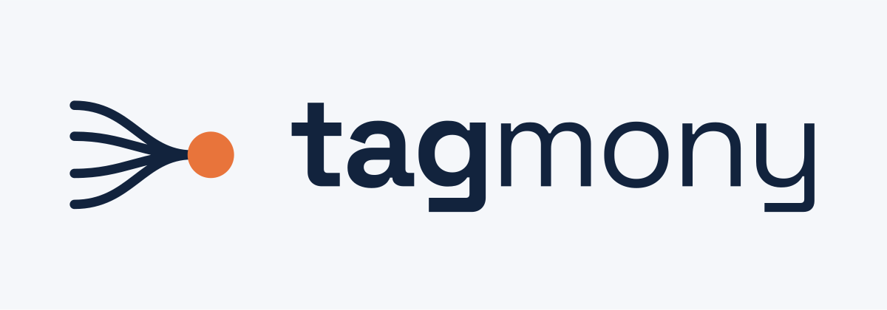

# Tagmony brand identity

**Tags in harmony.** Tagmony identifies music files, gathers metadata from several providers, and resolves them into one correct set of tags.

## The mark

Four strands converge into a single orange note. The strands are the metadata providers (MusicBrainz, Discogs, Deezer and others); the note is the one resolved value written to the file. The mark always reads left to right: many sources in, one result out.

## Package contents

| Folder | Contents |
|---|---|
| `svg/` | Master artwork. Text is converted to outlines, so no font is needed to display it. |
| `png/` | Raster exports: logos at 2×, app icons, favicons, `favicon.ico` (16, 32, 64 px). |
| `web/` | `tokens.css`, `tokens.json`, `site.webmanifest`, and the `<head>` snippet for favicons. |
| `fonts/` | Space Grotesk (Regular, Medium, Bold) with its SIL Open Font License. |

### Which file to use

| Need | File |
|---|---|
| App header, README banner, website | `svg/tagmony-logo-horizontal.svg` (light backgrounds) or `svg/tagmony-logo-horizontal-white.svg` (dark backgrounds) |
| GitHub social preview | `png/tagmony-social-preview.png` (navy, recommended) or `png/tagmony-social-preview-light.png`, both 1280 × 640 |
| Slides, documents | `png/tagmony-logo-horizontal-on-light@2x.png` or `png/tagmony-logo-horizontal-on-navy@2x.png` |
| Square layouts, splash screens | `svg/tagmony-logo-stacked-tagline.svg` |
| Mark alone (avatar, watermark) | `svg/tagmony-mark.svg`, `svg/tagmony-mark-white.svg` |
| One-color printing or embossing | `svg/tagmony-mark-mono-navy.svg` |
| Browser tab | `svg/favicon.svg` + `png/favicon.ico` |
| Home screen / PWA | `png/apple-touch-icon-180.png`, `png/tagmony-app-icon-192.png`, `png/tagmony-app-icon-512.png`, `png/tagmony-app-icon-maskable-512.png` |
| Docker Hub / GHCR avatar | `png/tagmony-app-icon-512.png` |

## GitHub social preview

In the repository, open **Settings → General → Social preview**, choose **Edit → Upload an image**, and upload `png/tagmony-social-preview.png`. The image is 1280 × 640 px and well under GitHub's 1 MB limit. All content sits in the central area, so nothing important is lost when sites crop the image. Note that social previews of private repositories are only visible to people with access to the repository.

## Wordmark

- Always lowercase: **tag**mony. In running text, write the name as "Tagmony".
- "tag" in Space Grotesk Bold, "mony" in Space Grotesk Regular, set as one word with slightly tight tracking.
- Do not retype the wordmark; use the outlined SVGs.

## Colors

| Name | Hex | Use |
|---|---|---|
| Score navy | `#12233D` | Primary brand color, text, icon background, app header |
| Raised navy | `#1C3357` | Inputs and panels on navy |
| Resolve orange | `#E8743B` | The resolved note in the mark; primary actions. Use sparingly. |
| Slate | `#4A5A70` | Secondary text on light backgrounds |
| Mist | `#F5F7FA` | App background |
| Rule | `#DDE3EA` | Borders and dividers |
| Paper | `#FFFFFF` | Cards |
| Muted on navy | `#B8C4D6` | Secondary text on navy |

Orange marks the result, not decoration: in the UI it is reserved for the primary action (for example "Write tags") and the current navigation item. Navy text on orange is the accessible pairing for buttons; do not put white text on orange.

## Typography

Space Grotesk throughout the interface:

- **Bold (700):** names and headings — album, artist, page titles.
- **Medium (500):** labels, navigation, field names.
- **Regular (400):** values and body text.

## Icon sizes

The mark simplifies as it gets smaller so it stays legible: four strands at 96 px and above, three strands at 64 px, two strands at 32 and 16 px. The orange note is always present.

## Clear space and minimum size

- Keep clear space around the logo equal to the diameter of the orange note.
- Minimum width for the horizontal logo: 120 px on screen. Below that, use the mark or app icon alone.

## Don'ts

- Don't recolor the strands orange or the note navy (except the one-color mark).
- Don't flip, rotate or reverse the mark; it must read left to right.
- Don't change the number of strands except as the icon sizes above specify.
- Don't add shadows, gradients or outlines, or place the logo on busy photos.
- Don't stretch the logo or change the spacing between the mark and wordmark.

## Design source

The concepts and the original artboards live on the Tagmony canvas in Claude: <https://claude.ai/artifact/NAjzh86d7CxvoJwSoaWBhM>. The files in this package are the production masters.

## Licenses

Space Grotesk © 2020 The Space Grotesk Project Authors, licensed under the SIL Open Font License 1.1 (`fonts/OFL.txt`). The font may be bundled with the app; the license must travel with it.
