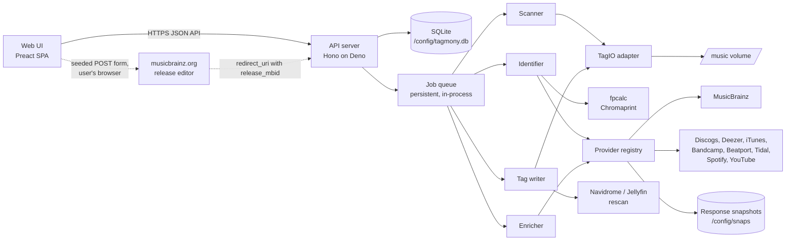
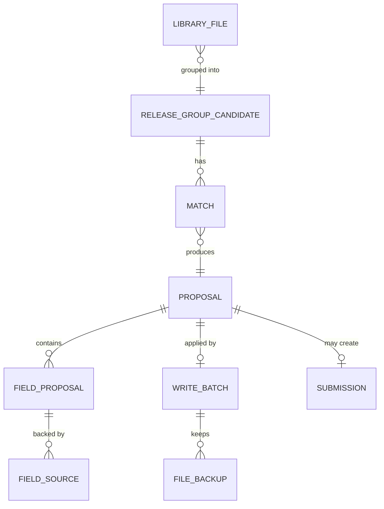
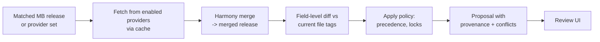
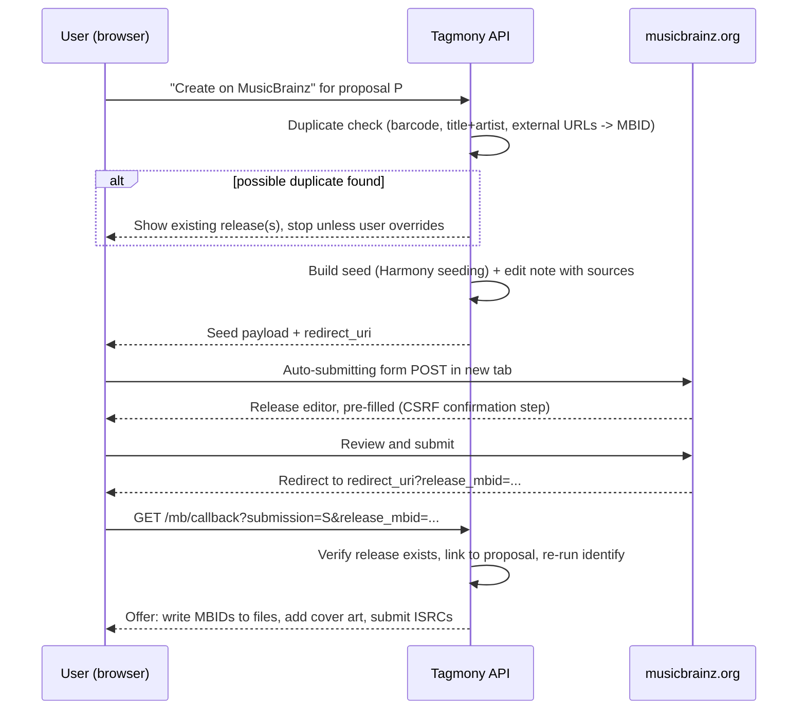

# Tagmony — Architecture

> **Tags in harmony.** A self-hosted web app that identifies music files, gathers metadata from several providers, merges it with per-field provenance, writes Picard-compatible tags, and helps submit missing releases to MusicBrainz.

| | |
|---|---|
| Status | Draft 1, design baseline for implementation |
| Audience | Maintainer, and the Claude Code agent implementing it |
| Last updated | 2026-11-23 (Phase 0 findings: D7–D15) |

This document is the source of truth for design decisions. When implementation reveals that a decision is wrong, update this file in the same pull request as the code change, and record the change in [§17 Decision log](#17-decision-log).

---

## Table of contents

1. [Goals and non-goals](#1-goals-and-non-goals)
2. [Users and core workflows](#2-users-and-core-workflows)
3. [System overview](#3-system-overview)
4. [Technology stack](#4-technology-stack)
5. [Repository layout](#5-repository-layout)
6. [Domain model](#6-domain-model)
7. [Library scanning](#7-library-scanning)
8. [Identification and matching](#8-identification-and-matching)
9. [Provider layer](#9-provider-layer)
10. [Merge and conflict model](#10-merge-and-conflict-model)
11. [Tag reading and writing](#11-tag-reading-and-writing)
12. [MusicBrainz submission (seeding)](#12-musicbrainz-submission-seeding)
13. [Music server integration](#13-music-server-integration)
14. [Security](#14-security)
15. [Deployment](#15-deployment)
16. [Implementation roadmap](#16-implementation-roadmap)
17. [Decision log](#17-decision-log)
18. [Open questions](#18-open-questions)
19. [References](#19-references)

---

## 1. Goals and non-goals

### Goals

- **G1 — Correct identification.** Every release in the library is matched to a specific MusicBrainz release (edition), not just an album title.
- **G2 — Multi-provider enrichment.** Combine MusicBrainz with other providers (Discogs, Deezer, iTunes, Bandcamp, Beatport, Tidal, Spotify, YouTube) to fill gaps and expose disagreements.
- **G3 — Provenance.** Every proposed value records which provider(s) supplied it. The user can see why a value was chosen.
- **G4 — Human review before writes.** Nothing is written below a confidence threshold without approval. Every write is reversible.
- **G5 — Music-server compatibility.** Tags written are compatible with how MusicBrainz Picard writes them, so Navidrome and Jellyfin read them correctly (multi-valued artists, MBIDs, M4A atoms, OGG cover art).
- **G6 — Contribute back.** When a release is missing from MusicBrainz, build it from other providers and seed the MusicBrainz release editor so the user can submit it.
- **G7 — Homelab-first operations.** One Docker image, one mounted music volume, authentication on by default, works on ARM NAS devices.

### Non-goals (v1)

- Playing music or replacing Navidrome or Jellyfin.
- Downloading music from any source.
- Fully automatic, unattended submission to MusicBrainz. Submission always goes through the user's own browser session.
- Multi-tenant SaaS hosting. Tagmony is a single-household app; multiple local users are a later feature.
- Editing video files, podcasts or audiobooks.

### Supported audio formats (v1)

| Format | Container / tag system | Notes |
|---|---|---|
| FLAC | Vorbis comments + PICTURE block | Native multi-value via repeated fields |
| OGG Vorbis | Vorbis comments | Cover art in `METADATA_BLOCK_PICTURE` (base64 FLAC picture block) |
| Opus (`.opus`) | Vorbis comments (OpusTags) | Same as OGG Vorbis |
| MP3 | ID3v2.4 (read ID3v2.3 and v1) | Multi-value via null-separated frames and `TXXX` frames as Picard does |
| M4A / AAC / ALAC | MP4 atoms | Multi-value must be stored inside **one** atom, not duplicated atoms |

---

## 2. Users and core workflows

**Personas**

- *Homelab user*: runs Navidrome or Jellyfin on a NAS, wants a clean library without installing desktop software.
- *Collector*: cares about the exact edition (label, catalog number, barcode, country, media), classical credits, and source provenance.

**Workflows**

| ID | Workflow | Outcome |
|---|---|---|
| W1 | Scan library | Files indexed, grouped into release candidates, current tags read |
| W2 | Identify release | Candidate matched to a MusicBrainz release with a confidence score |
| W3 | Enrich and review | Merged proposal shown per field with sources and conflicts; user approves, edits or locks fields |
| W4 | Write tags | Backup taken, tags written atomically, music server rescan triggered |
| W5 | Undo | Any write batch restored from its backup |
| W6 | Release missing on MusicBrainz | Data aggregated from other providers, duplicate check, release editor seeded in a new tab; on return, MBIDs written to files |
| W7 | Inbox / watch folder | New arrivals detected and queued for W2 to W4 |

---

## 3. System overview



Key properties:

- **Single process.** The API server and the workers run in one Deno process. Long work runs in the job queue, never in a request handler.
- **Database-backed state.** Jobs, proposals, decisions and write backups live in SQLite, so restarts resume cleanly.
- **Provider responses are cached as snapshots**, so a proposal can be re-derived and edit notes can cite what was seen at the time.
- **The browser, not the server, talks to the MusicBrainz release editor.** The server never holds MusicBrainz credentials.

---

## 4. Technology stack

| Concern | Choice | Rationale |
|---|---|---|
| Runtime | **Deno 2** (TypeScript) | Same runtime as Harmony, whose provider, merge and seeding code we reuse; single language across UI and server; `deno compile` and good Docker story |
| HTTP framework | **Hono** | Small, typed, runs on Deno, easy middleware for auth and CSRF |
| Frontend | **Preact + Vite**, TypeScript, built to static files served by the API | Small bundle; no SSR needed for a self-hosted tool |
| Database | **SQLite** in WAL mode, file at `/config/tagmony.db` | Zero-ops for homelab users; one writer is enough |
| Migrations | Plain numbered SQL files in `server/db/migrations`, applied at startup | Transparent and reviewable |
| Metadata aggregation | **Harmony** (MIT, `kellnerd/harmony`) providers, harmonized types, merge and seeding modules | Avoid re-implementing a dozen providers and the MusicBrainz seeding format |
| Fingerprinting | **Chromaprint `fpcalc`** binary + AcoustID web API | Standard, used by Picard and beets |
| Tag I/O | Behind the `TagIO` interface; implementation chosen by spike in Phase 0 (see [§11.4](#114-tagio-implementation-spike)) | Tag-writing correctness is the riskiest part; decide with tests, not assumptions |
| Containers | Multi-arch image (amd64, arm64) | NAS devices are often ARM |

### 4.1 Reusing Harmony

Harmony is TypeScript; most modules use web standards and run outside its Fresh server. Its relevant parts:

- `providers/` — one provider per subfolder, base classes in `providers/base.ts`, registry in `providers/registry.ts`
- `harmonizer/types.ts` and `harmonizer/merge.ts` — harmonized release type and merge algorithm
- `musicbrainz/seeding.ts` — release editor seeding
- `musicbrainz/mbid_mapping.ts` — resolving external IDs and URLs to MBIDs
- `lookup.ts` — combined lookup by GTIN, URL or provider ID

**Integration rules**

1. Vendor Harmony as a **git submodule pinned to a specific commit** at `vendor/harmony`. Never track a moving branch.
2. Import only from the modules listed above, through a thin adapter in `server/providers/harmony_adapter.ts`. No other code imports Harmony directly.
3. Do not import Harmony's `server/` (Fresh) code.
4. Keep Harmony's MIT license notice in `THIRD_PARTY_NOTICES.md` and in the built image.
5. Upstream bug fixes to Harmony when possible instead of patching the vendored copy. If a local patch is unavoidable, keep it as a `.patch` file applied at build time and list it in the decision log.
6. **Phase 0 must verify** that the listed modules import cleanly under Deno without the Fresh server and that the provider credentials they need can be supplied from Tagmony's config. If not, record the gap and adapt.

---

## 5. Repository layout

```text
tagmony/
├── docs/
│   └── ARCHITECTURE.md        # this file
├── CLAUDE.md                  # agent instructions (root so Claude Code loads it automatically)
├── LICENSE                    # GPL-3.0 (D17)
├── README.md
├── THIRD_PARTY_NOTICES.md
├── deno.json                  # tasks, imports, compiler options
├── Dockerfile
├── docker-compose.example.yml
├── docker/
│   └── dev.Dockerfile         # dev/test toolchain image (D13)
├── scripts/
│   ├── dk                     # run a command in the dev container
│   ├── gen_fixtures.sh        # generate tests/fixtures/audio
│   └── gen_library.ts         # synthetic library in dev/music for scale checks
├── vendor/
│   └── harmony/               # git submodule, pinned commit
├── server/
│   ├── main.ts                # boot: config, migrations, queue, HTTP
│   ├── config.ts              # env, validated
│   ├── settings.ts            # /config/settings.json, validated
│   ├── log.ts                 # structured logging with secret redaction (§14.3)
│   ├── auth/                  # Argon2id passwords, sessions, login throttle, admin bootstrap
│   ├── fs/
│   │   └── safe_path.ts       # music-root confinement (§14.4)
│   ├── http/
│   │   ├── app.ts             # Hono app, middleware order
│   │   ├── auth.ts            # sessions, login, CSRF
│   │   └── routes/            # one file per resource
│   ├── db/
│   │   ├── db.ts              # node:sqlite, WAL, migration runner (D19)
│   │   ├── migrations/        # 0001_init.sql, ...
│   │   └── repo/              # typed data-access functions
│   ├── jobs/
│   │   ├── queue.ts           # persistent queue, retries, cancellation
│   │   ├── scan.ts
│   │   ├── identify.ts
│   │   ├── enrich.ts
│   │   └── write.ts
│   ├── scanner/               # walk.ts, group.ts, scan.ts (§7)
│   ├── identify/              # candidate search, scoring, fingerprint
│   ├── providers/
│   │   ├── harmony_adapter.ts
│   │   ├── ratelimit.ts       # per-provider token buckets
│   │   ├── youtube.ts         # Tagmony-owned provider (see §9.5)
│   │   └── registry.ts
│   ├── merge/                 # proposal building, policy, locks
│   ├── tagio/
│   │   ├── types.ts           # TagIO interface, canonical tag model
│   │   ├── mapping.ts         # canonical field -> per-format keys
│   │   ├── atomic.ts          # temp copy, fsync, rename (§11.1)
│   │   ├── verify.ts          # round-trip verification (§11.3)
│   │   ├── schema.ts          # runtime validation of sidecar output
│   │   ├── sniff.ts           # magic-byte format check (§7)
│   │   └── impl/
│   │       ├── mutagen.ts           # production TagIO: client for the sidecar (D7)
│   │       ├── mutagen_sidecar.py   # Python/mutagen process, NDJSON over stdio
│   │       └── taglib_wasm.ts       # spike implementation, kept for re-evaluation
│   ├── musicbrainz/
│   │   ├── seed.ts            # wraps Harmony seeding, adds edit note
│   │   └── callback.ts        # redirect_uri handler
│   └── integrations/
│       ├── navidrome.ts
│       └── jellyfin.ts
├── web/                       # Preact SPA
│   ├── src/
│   │   ├── pages/             # Library, Review, Providers, Submit, Settings
│   │   ├── components/
│   │   └── api.ts             # typed client generated from server types
│   └── vite.config.ts
├── shared/
│   └── types.ts               # API DTOs shared by server and web
└── tests/
    ├── fixtures/
    │   ├── audio/             # generated test files (see §11.5), gitignored
    │   ├── generate_audio.py  # reference writer (ffmpeg + mutagen)
    │   ├── fixture_tags.json  # canonical tags the fixtures carry
    │   ├── picard_tag_map.tsv # extract of Picard's tag mapping table
    │   └── snaps/             # recorded provider responses
    ├── helpers/               # replaying fetch, shared test utilities
    ├── tagio/                 # conformance suite, raw inspector
    ├── merge/
    ├── identify/
    └── e2e/
```

---

## 6. Domain model

### 6.1 Entities



| Entity | Purpose | Key columns |
|---|---|---|
| `library_file` | One audio file on disk | `id`, `path` (relative to music root), `size`, `mtime`, `format`, `duration_ms`, `fingerprint`, `acoustid_id`, `current_tags` (JSON), `pictures` (JSON metadata, no bytes), `read_error`, `candidate_id`, `scanned_at` |
| `candidate` | A group of files believed to form one release (usually a folder) | `id`, `group_key` (stable across rescans), `folder`, `hint_artist`, `hint_album`, `hint_mbid`, `hint_track_count`, `content_hash`, `status`; member files point to it via `library_file.candidate_id` |
| `match` | A scored MusicBrainz release for a candidate | `candidate_id`, `release_mbid`, `score`, `method` (`existing_mbid`, `text`, `fingerprint`, `barcode`, `manual`), `track_mapping` (JSON) |
| `proposal` | Merged metadata for one candidate + chosen match | `id`, `candidate_id`, `release_mbid` (nullable for not-in-MB), `state` (`draft`, `needs_review`, `approved`, `written`, `discarded`), `created_at` |
| `field_proposal` | One canonical field, release- or track-level | `proposal_id`, `scope` (`release` or track position), `field`, `current_value`, `proposed_value`, `decision` (`auto`, `accepted`, `edited`, `kept_current`), `locked` |
| `field_source` | Provenance for a field value | `field_proposal_id`, `provider`, `value`, `snapshot_id`, `agrees_with_proposed` |
| `write_batch` | One user-approved write operation | `id`, `proposal_id`, `started_at`, `finished_at`, `status`, `error` |
| `file_backup` | Pre-write tag snapshot for undo | `write_batch_id`, `file_id`, `tags_before` (JSON), `pictures_before` (blob refs) |
| `submission` | A MusicBrainz seeding attempt | `id`, `proposal_id`, `seed_payload` (JSON), `state` (`seeded`, `returned`, `abandoned`), `release_mbid` |
| `field_lock` | User's standing "never change this" rule | `scope` (`file`, `release`, `global_field`), `target`, `field` |
| `job` | Queue entry | `id`, `kind`, `payload`, `state`, `attempts`, `run_after`, `error` |
| `snapshot` | Cached provider response | `id`, `provider`, `request_key`, `fetched_at`, `body_path` |

### 6.2 Canonical tag model

All internal code uses one canonical model, independent of file format. Names follow Picard's internal tag names so the mapping to formats can follow Picard's documentation.

```ts
// server/tagio/types.ts (sketch)
export type Multi = string[];          // always arrays for multi-valued fields

export interface CanonicalTags {
  // track-level
  title?: string;
  artist?: string;                     // display credit, e.g. "Alice feat. Bob"
  artists?: Multi;                     // individual names
  artistsort?: string;
  tracknumber?: number;
  totaltracks?: number;
  discnumber?: number;
  totaldiscs?: number;
  isrc?: Multi;
  composer?: Multi;
  lyricist?: Multi;
  conductor?: Multi;
  performer?: Record<string, Multi>;   // role -> names
  work?: string;
  musicbrainz_recordingid?: string;
  musicbrainz_trackid?: string;        // release-track MBID (Picard's name; see D8)
  musicbrainz_artistid?: Multi;
  musicbrainz_workid?: Multi;
  acoustid_id?: string;

  // release-level (written to every track of the release)
  album?: string;
  albumartist?: string;
  albumartists?: Multi;
  albumartistsort?: string;
  date?: string;                       // YYYY, YYYY-MM or YYYY-MM-DD
  originaldate?: string;
  label?: Multi;
  catalognumber?: Multi;
  barcode?: string;
  media?: string;
  releasecountry?: string;
  releasestatus?: string;
  releasetype?: Multi;
  script?: string;
  language?: string;
  genre?: Multi;
  musicbrainz_albumid?: string;
  musicbrainz_releasegroupid?: string;
  musicbrainz_albumartistid?: Multi;

  // provider IDs (custom tags, see §11.2)
  discogs_release_id?: string;
  deezer_album_id?: string;
  // ...one per enabled provider
}

export interface Picture {
  type: "front" | "back" | "other";
  mime: string;                        // any image/* read from files; Tagmony writes JPEG/PNG (D11)
  data: Uint8Array;
  description?: string;
}
```

---

## 7. Library scanning

**Input:** the music root (`/music` in the container). Paths stored in the database are always **relative** to the root.

**Steps**

1. Walk the tree, skipping hidden entries, `@eaDir` (Synology), `#recycle`, configured ignore globs (`settings.json` → `scanner.ignore`) and all symlinks (D21).
2. For each audio file (by extension and magic bytes), compare `size` + `mtime` with the database. Unchanged files are skipped.
3. Read tags and technical properties through `TagIO.read`. Store the canonical tags as `current_tags`.
4. **Grouping into candidates:**
   - Primary: files in the same folder that share `album` + `albumartist` (or `musicbrainz_albumid` when present). The track artist is not part of the key, so compilations stay together (D22).
   - Multi-disc folders (`CD1`, `Disc 2`, ...) under one parent are merged into one candidate when album tags agree.
   - A folder with mixed albums is split by album tag; files with no album tag stay a "loose files" candidate for fingerprinting.
5. Enqueue `identify` jobs for new or changed candidates. Until Phase 2 adds the identifier, the scan result lists them (`candidatesTouched`) and their `status` is `new` or `changed`.

Scanning only reads the library (it runs in read-only mode too). Unreadable files are kept with a `read_error`, so the UI can show them.

**Watch mode (W7):** use `Deno.watchFs` on an optional inbox folder; debounce events for 30 s after the last change before scanning, so partial copies are not processed. Polling fallback every N minutes for network filesystems where inotify does not work (SMB/NFS mounts are common on NAS setups).

---

## 8. Identification and matching

Identification runs in this order and stops at the first confident result:

| Order | Method | When | Notes |
|---|---|---|---|
| 1 | Existing MBIDs | Files already have `musicbrainz_albumid` | Verify the release still exists (it may have been merged; follow redirects) |
| 2 | Barcode / catalog number | Tags contain `barcode` or `catalognumber` | Exact lookup |
| 3 | Text search | Album + artist + track count available | MusicBrainz release search, then score |
| 4 | Fingerprint | Text search weak or tags missing | `fpcalc` per file → AcoustID → recordings → releases containing them |
| 5 | Manual | All else fails | User pastes a MusicBrainz, Discogs, Deezer, Bandcamp, ... URL |

### 8.1 Scoring

Each candidate release gets a score from 0 to 1, a weighted sum of:

| Signal | Weight (initial) | How |
|---|---|---|
| Track count match | 0.20 | Exact = 1, off by one = 0.5 (bonus tracks), else 0 |
| Track durations | 0.25 | Mean absolute difference, mapped through a tolerance curve (≤ 3 s per track is a strong match) |
| Track titles | 0.20 | Normalized string similarity per position |
| Album title | 0.10 | Normalized similarity |
| Artist credit | 0.10 | Normalized similarity on album artist |
| Fingerprint coverage | 0.15 | Share of files whose AcoustID recordings appear on this release |
| Barcode / catalog number | override | Exact match sets a floor of 0.95 |

Weights live in config and are tuned using a labelled fixture set in `tests/identify/`. Thresholds:

- `score ≥ auto_threshold` (default 0.92) → proposal can be auto-approved **only** if the user enabled auto-approve; otherwise `needs_review`.
- `review_threshold ≤ score < auto_threshold` (default 0.70) → `needs_review`, show top 3 candidates.
- below `review_threshold` → "no confident match", offer manual search and the W6 flow.

### 8.2 Edition picking

When several releases in the same release group score within 0.03 of each other (common: same album, different countries or pressings), the UI shows an **edition picker** listing country, date, label, catalog number, barcode, media format and track count side by side. Never silently pick one edition for a collector.

### 8.3 Track mapping

Matching produces an explicit mapping from file to (medium, position). Mapping uses duration and title similarity with the Hungarian algorithm, so files in the wrong order still map correctly. Unmapped files and unmatched release tracks are shown in the review UI.

---

## 9. Provider layer

### 9.1 Interface

Tagmony wraps every provider (Harmony-backed or its own) behind one interface:

```ts
// server/providers/types.ts (sketch)
export interface ProviderInfo {
  id: string;                    // "musicbrainz", "discogs", ...
  displayName: string;
  requiresCredentials: boolean;
  tier: "core" | "enrichment" | "optional";
  rateLimit: { requests: number; perMs: number };  // from config, see §9.3
}

export interface Provider {
  info: ProviderInfo;
  lookupByUrl?(url: string): Promise<HarmonizedRelease | null>;
  lookupByGtin?(gtin: string, region?: string): Promise<HarmonizedRelease[]>;
  lookupById?(id: string): Promise<HarmonizedRelease | null>;
  search?(q: { artist?: string; album?: string; trackCount?: number }): Promise<HarmonizedRelease[]>;
}
```

`HarmonizedRelease` is Harmony's harmonized release type, re-exported through the adapter so the rest of Tagmony does not depend on Harmony's file layout.

### 9.2 Provider tiers

| Tier | Providers | Default | Credentials |
|---|---|---|---|
| Core | MusicBrainz, Cover Art Archive, AcoustID | On | AcoustID application API key (free, user-supplied) |
| Enrichment | Discogs, Deezer, iTunes | On (Discogs only if credentials are set) | Discogs consumer key + secret (what Harmony's provider uses, D12) |
| Optional | Bandcamp, Beatport, Tidal, Spotify | Off | Per provider; Spotify and Tidal need app credentials. Bandcamp and Beatport have no official API; Harmony reads their public pages, so they are opt-in only and never on by default (D16) |
| Optional, evidence only | YouTube | Off | YouTube Data API key |

Commercial APIs change without notice (Spotify has removed endpoints that Harmony relied on). Every optional provider must degrade to "unavailable" without breaking a lookup.

### 9.3 Rate limiting and politeness

- One **token bucket per provider**, configured in `settings.json`. Defaults must be conservative and documented with the date they were checked.
- **MusicBrainz:** at most 1 request per second on average, and every request sends a meaningful `User-Agent`, `Tagmony/<version> ( https://github.com/cdalamagkas/tagmony )` (`server/version.ts`, D18). Allow pointing the base URL at a local MusicBrainz mirror for large libraries.
- Retries: exponential backoff with jitter on 429/503; respect `Retry-After`.
- All provider calls go through the snapshot cache (§9.4) first.

> Verify each provider's current published limits during Phase 2 and record them in the decision log. Do not hard-code numbers from memory.

### 9.4 Snapshot cache

Harmony's base provider caches responses as snapshots keyed by request URL and timestamp. Tagmony keeps this behaviour, with storage under `/config/snaps/`:

- Default TTL: 30 days for release lookups, 1 day for searches.
- A proposal stores the snapshot IDs it was built from, so the review UI and the MusicBrainz edit note can show exactly what each provider returned.
- `Settings → Cache` shows size and offers purge by provider or age.

### 9.5 YouTube provider (Tagmony-owned)

Harmony has no merged YouTube Music provider, so Tagmony implements a minimal one.

- **Official YouTube Data API only.** No unofficial or internal YouTube Music APIs in the default build, because of terms-of-service risk and breakage.
- **Input:** a video or playlist URL pasted by the user. Avoid `search.list`, which has a small separate daily quota by default; `videos.list` and `playlistItems.list` are cheap.
- **Extraction:** parse auto-generated "Provided to YouTube by ..." descriptions for label, ℗/© line and "Released on" date; playlist order for track sequence; durations from `contentDetails`.
- **Trust level:** evidence only. YouTube values can fill gaps and corroborate, but cannot by themselves set the tracklist, artist credits or release type when another provider disagrees. YouTube exposes no barcode.

---

## 10. Merge and conflict model

### 10.1 Pipeline



### 10.2 Per-field provenance

For every canonical field, the proposal records every provider's value (normalized) and which ones agree with the proposed value. The UI shows chips per source and a conflict badge when sources disagree after normalization.

**Normalization before comparison** (comparison only; the proposed value keeps its original form):

- Unicode NFC, trimmed whitespace, collapsed internal spaces.
- Case-insensitive comparison for titles and names.
- Typographic apostrophes and quotes treated as equal to ASCII ones.
- Dates compared at the precision both sides have (`2019` agrees with `2019-05-03`).
- Barcodes compared as digits only, with leading zeros normalized (UPC-A vs EAN-13).

### 10.3 Precedence policy

Default policy, configurable per field in settings:

| Field group | Precedence | Reason |
|---|---|---|
| Identity: MBIDs, tracklist, track artists, release artist | MusicBrainz only | Music servers key on MusicBrainz data |
| Release date | MusicBrainz → Deezer → iTunes → Discogs | Streaming stores often have precise day-level dates when MB has only a year |
| Original date | MusicBrainz (release group first release) | |
| Label, catalog number, barcode, country, media | MusicBrainz → Discogs | Discogs is strongest for physical pressings |
| Genre | Configurable: MusicBrainz genres, Discogs genres/styles, or none | Genre is subjective; default off to avoid surprises |
| Cover art | Cover Art Archive → largest available from other providers | Show resolution and source in the UI |
| ISRC | MusicBrainz → Deezer → Spotify | |
| Provider IDs | Each provider for its own ID | |

**Rules**

1. A **locked** field is never changed. Locks are set per file, per release, or globally per field.
2. A field whose current value already agrees with the proposed value (after normalization) is marked "unchanged" and not rewritten.
3. If the highest-precedence provider has no value, fall through to the next one, and mark the field as "filled by fallback" in the UI.
4. When two or more providers disagree and none is authoritative for the field, mark the field as a **conflict**; the proposal cannot be auto-approved while it has unresolved conflicts.

### 10.4 "Not in MusicBrainz" proposals

When no MusicBrainz release matches (W6), the proposal is built from the other providers via Harmony's merge, with `release_mbid = null`. It can be written to files without MBIDs (user's choice), and it is the input to seeding (§12).

---

## 11. Tag reading and writing

### 11.1 TagIO interface

```ts
// server/tagio/types.ts (sketch)
export interface TagIO {
  // pictureData: false returns picture type/mime/size without the bytes (the scanner's case, D24)
  read(path: string, options?: { pictureData?: boolean }): Promise<{ tags: CanonicalTags; pictures: Picture[]; audio: AudioProps; raw: RawTagDump }>;
  write(path: string, change: TagChange): Promise<void>;
}

export interface TagChange {
  set: Partial<CanonicalTags>;     // fields to set (arrays replace wholesale)
  remove: (keyof CanonicalTags)[]; // fields to delete
  pictures?: Picture[];            // replace all pictures when present
}
```

`write` must be **atomic**: write to a temporary file in the same directory, `fsync`, then rename over the original. Preserve the original file's permissions and ownership. Never re-encode audio.

### 11.2 Format mapping

Follow MusicBrainz Picard's tag mapping table as the authoritative reference (link in [§19](#19-references)). The table below lists the high-risk fields; `server/tagio/mapping.ts` contains the full mapping and the conformance tests in `tests/tagio/` must assert it.

| Canonical | ID3v2.4 | Vorbis comment (FLAC/OGG/Opus) | MP4 |
|---|---|---|---|
| `title` | `TIT2` | `TITLE` | `©nam` |
| `artist` | `TPE1` | `ARTIST` | `©ART` |
| `artists` | `TXXX:ARTISTS` (multi) | `ARTISTS` (repeated) | `----:com.apple.iTunes:ARTISTS` (one atom, multiple values) |
| `albumartist` | `TPE2` | `ALBUMARTIST` | `aART` |
| `album` | `TALB` | `ALBUM` | `©alb` |
| `tracknumber` / `totaltracks` | `TRCK` (`n/total`) | `TRACKNUMBER`, `TRACKTOTAL` **and** `TOTALTRACKS` | `trkn` |
| `discnumber` / `totaldiscs` | `TPOS` | `DISCNUMBER`, `DISCTOTAL` **and** `TOTALDISCS` | `disk` |
| `isrc` | `TSRC` | `ISRC` | `----:com.apple.iTunes:ISRC` |
| `musicbrainz_albumid` | `TXXX:MusicBrainz Album Id` | `MUSICBRAINZ_ALBUMID` | `----:com.apple.iTunes:MusicBrainz Album Id` |
| `musicbrainz_recordingid` | `UFID:http://musicbrainz.org` | `MUSICBRAINZ_TRACKID` | `----:com.apple.iTunes:MusicBrainz Track Id` |
| `musicbrainz_trackid` (release track) | `TXXX:MusicBrainz Release Track Id` | `MUSICBRAINZ_RELEASETRACKID` | `----:com.apple.iTunes:MusicBrainz Release Track Id` |
| `work` | `TXXX:WORK` | `WORK` | `©wrk` |
| `originaldate` | `TDOR` | `ORIGINALDATE` | `----:com.apple.iTunes:originaldate` (D9) |
| `performer` | `TMCL` (role, name pairs) | `PERFORMER=Name (role)` | not stored, as in Picard (D9) |
| `albumartists` | `TXXX:ALBUMARTISTS` | `ALBUMARTISTS` | `----:com.apple.iTunes:ALBUMARTISTS` (not in Picard's table, D8) |
| front cover | `APIC` type 3 | FLAC: `PICTURE` block; OGG/Opus: `METADATA_BLOCK_PICTURE` | `covr` |
| provider IDs | `TXXX:DISCOGS_RELEASE_ID`, ... | `DISCOGS_RELEASE_ID`, ... | `----:com.apple.iTunes:DISCOGS_RELEASE_ID`, ... |

> Note that Picard's naming is historical: Vorbis `MUSICBRAINZ_TRACKID` holds the **recording** MBID, while `MUSICBRAINZ_RELEASETRACKID` holds the release-track MBID. Every row was verified against the Picard documentation in Phase 0 (2026-11-23): `tests/tagio/mapping.test.ts` checks `mapping.ts` against an extract of Picard's table (`tests/fixtures/picard_tag_map.tsv`), and the conformance tests are the final word. MP4 `covr` has no picture-type field, so MP4 covers always read back as front covers (D10).

**Multi-value rules**

- `artist` holds the display credit as one string (e.g. "Alice feat. Bob"); `artists` holds the individual names. Write both, as Picard does.
- ID3v2.4: multiple values are null-separated within one frame. Offer an ID3v2.3 compatibility option that joins with `/` or a configured separator (v2.3 has no native multi-value).
- MP4: all values in **one** freeform atom. Duplicate atoms make Navidrome show only one artist.
- Never split on `&`, `/`, `,` when **reading** unless the user enables a separator rule; names like "AC/DC" and "Simon & Garfunkel" break otherwise.

### 11.3 Write procedure

1. Re-read the file and compare with the state the proposal was built from. If tags changed on disk since then, abort that file and mark the proposal stale.
2. Store `file_backup` (tags and pictures before) in the database.
3. Apply `TagChange` atomically (§11.1).
4. Re-read and verify the written fields round-trip. On mismatch, restore from backup and record the error.
5. Mark the batch complete; enqueue a music-server rescan (§13).

Undo (W5) re-applies `tags_before` and `pictures_before` through the same atomic write path.

Optional, off by default: **rename/move files** using a template (e.g. `{albumartist}/{date:4} - {album}/{discnumber}-{tracknumber:02} {title}`). Renames are journaled the same way as tag writes so they can be undone.

### 11.4 TagIO implementation spike

Phase 0 evaluates candidate implementations against the conformance suite (§11.5) and picks one:

| Option | Description | Watch for |
|---|---|---|
| A | A TagLib-based library usable from Deno (a WebAssembly build of TagLib, or `node-taglib-sharp` via Deno's npm compatibility) | M4A multi-value atoms, OGG/Opus pictures, ID3v2.4 multi-value frames |
| B | A small Python sidecar using **mutagen**, called over a local Unix socket or stdin/stdout JSON | Adds Python to the image, but mutagen is the most battle-tested tag library |

**Decision rule:** choose the first option that passes 100% of the conformance suite on all five formats. If A fails any test that matters for Navidrome/Jellyfin and the failure cannot be fixed quickly, choose B. Record the result in the decision log. Reading for the scanner may use a faster read-only library if it passes the read half of the suite.

**Result (Phase 0, 2026-11-23): option B, the mutagen sidecar (D7).** taglib-wasm 2.4.1 (TagLib 2.3.2) read every fixture correctly but failed 15 of 46 conformance steps on writes; mutagen passed all 46 plus the crash test. The sidecar is a long-lived `python3 -I` process speaking newline-delimited JSON on stdio. It receives `mapping.ts` at start-up, so the mapping has one source of truth, and only ever edits a temp copy; `atomic.ts` does the copy, fsync, mode/owner restore and rename.

### 11.5 Conformance test suite

Fixtures in `tests/fixtures/audio/` are **generated**, not committed binaries from real music:

- Generate short silent or tone files with `ffmpeg` in each format (FLAC, OGG Vorbis, Opus, MP3, M4A/AAC).
- Seed them with Picard-style tags and pictures using a reference writer (mutagen in a test-only container is fine).

Required test cases:

1. Round-trip every canonical field in every format.
2. Multi-value `artists` with 3 names, including names containing `&` and `/`.
3. M4A: multi-value stored in a single atom (inspect raw atoms).
4. OGG/Opus: front cover written as `METADATA_BLOCK_PICTURE`, readable after round-trip.
5. Unknown and custom tags already in the file are preserved after a write.
6. Unicode: Greek, Japanese, combining characters, emoji in titles.
7. Atomicity: a simulated crash mid-write leaves the original file intact.
8. Optional integration test: run Navidrome in Docker against the fixtures and assert via its API that multi-artist tracks show all artists. *(Deferred to Phase 3, whose "Done when" already requires a real Navidrome check.)*

Additional cases in the suite: a write changes nothing except the requested fields (raw before/after diff), field removal, `tracknumber` updates keep `totaltracks`, file mode is preserved, and ID3v2.3 is read without splitting `/`-joined values.

---

## 12. MusicBrainz submission (seeding)

MusicBrainz has no API for creating releases. The supported route is **seeding the release editor**: a POST of form fields to `https://musicbrainz.org/release/add`, which the user reviews and submits from their own logged-in account. Tagmony never sees MusicBrainz credentials, and a person reviews every submission.

### 12.1 Flow



### 12.2 Details

- **Seed building:** reuse Harmony's seeding module on the merged release. It also knows which data can only go into the annotation.
- **Edit note:** list every provider URL used, the Tagmony version, and a link format that identifies the snapshot timestamp. Keep it factual; MusicBrainz editors rely on edit notes.
- **redirect_uri:** `https://<tagmony-public-url>/mb/callback?submission=<id>`. MusicBrainz appends `release_mbid`. If the user has no public URL configured, the callback still works because it is opened by the user's own browser on the same network.
- **Callback security:** the `submission` id must belong to the logged-in user and be in state `seeded`; the `release_mbid` is verified by fetching it from the MusicBrainz API before anything is written.
- **Cover art:** cannot be seeded. After the callback, offer a link to the release's "Add cover art" page and show the best image found by providers with its source, so the user can upload it.
- **ISRCs:** offer the follow-up step for ISRC submission (Harmony also links to this). Do not automate it in v1.
- **Never** submit automatically or in bulk. One release, one human review.

### 12.3 Other seedable entities

Artists, labels and standalone recordings can be seeded with GET query parameters. v1 only links to "Add artist" when an artist in the seed has no MBID; full artist seeding is a later feature.

---

## 13. Music server integration

| Server | Action after a write batch | Auth |
|---|---|---|
| Navidrome | Subsonic API `startScan` (and poll `getScanStatus`) | Navidrome user + password or token, stored encrypted (§14.3) |
| Jellyfin | Trigger a library refresh via its REST API | API key |
| None | Nothing; user's server picks up changes on its own schedule | |

Debounce: at most one rescan request per server per minute, so a large batch does not trigger repeated scans.

---

## 14. Security

Tagmony has **read-write access to the user's entire music library** and stores third-party API credentials. Treat it as a sensitive service even on a home network.

### 14.1 Authentication

- **Authentication is mandatory.** On first start, the UI requires creating an admin account (or the admin password is supplied via `TAGMONY_ADMIN_PASSWORD_FILE`). There is no "auth disabled" mode; for reverse-proxy setups use OIDC or trusted-header mode below.
- Passwords hashed with **Argon2id** via `hash-wasm` (D20): 19 MiB, t=2, p=1 (OWASP minimum); minimum length 10.
- The UI's auth probe `GET /api/auth/session` is public alongside login and setup; it returns only whether setup is required, and the user and CSRF token of the caller's own session (D23).
- Login rate limiting per IP and per account, with exponential delay.
- **Sessions:** random 256-bit IDs; the database stores only their SHA-256. Cookie `HttpOnly`, `SameSite=Lax`, `Secure` when `TAGMONY_PUBLIC_URL` is https. Idle timeout (default 7 days) and absolute lifetime (default 30 days) set in `settings.json` → `auth`.
- **Optional OIDC** (Authorization Code + PKCE) for users who run an identity provider, with a configurable group/role claim for admin access.
- **Optional trusted-header mode** for users behind an authenticating reverse proxy: disabled by default, only accepted from configured proxy IPs.

### 14.2 Request security

- **CSRF:** synchronizer token for all state-changing API calls, plus `Origin`/`Referer` checks.
- **Content Security Policy:** `default-src 'self'`; images also allowed from configured cover-art hosts or proxied through Tagmony (preferred, so the browser never talks to third parties directly except for the MusicBrainz seeding tab).
- The seeding form POST to `musicbrainz.org` is the one intentional cross-origin navigation; it opens in a new tab with `rel="noopener noreferrer"`.
- Security headers: `X-Content-Type-Options: nosniff`, `Referrer-Policy: same-origin`, `frame-ancestors 'none'`.

### 14.3 Data protection

- Provider tokens and music-server credentials encrypted at rest with a key derived from `TAGMONY_SECRET_KEY` (or a key file in `/config` generated on first start, permissions `0600`).
- Secrets never returned by the API after being saved; the UI shows "set" / "not set".
- Logs never contain tokens, passwords, cookies or full provider URLs with credentials. Add a log redaction test.

### 14.4 Filesystem safety

- Every path from the database or API is resolved with `realpath` and must stay inside the music root. Reject symlinks that point outside it unless explicitly allowed.
- The container runs as a **non-root** user (`PUID`/`PGID` supported, as is common in homelab images).
- Writes use the atomic procedure in §11.1; free-space check before a batch.
- A global **read-only mode** switch for trying Tagmony safely on an existing library.

### 14.5 Outbound requests

- Providers only call their own fixed API hosts. User-supplied URLs (manual lookup, YouTube) are parsed and matched against a provider's host allowlist before any request, which prevents SSRF against the LAN.
- Image downloads (cover art) have size limits (e.g. 20 MB) and MIME sniffing.

### 14.6 Supply chain

- Pin Deno, npm and Harmony versions; commit `deno.lock`.
- Dependabot/Renovate on the repo; image built in CI with SBOM generation and an image vulnerability scan.

---

## 15. Deployment

### 15.1 Image

- Multi-stage build: build the web SPA, then a runtime image containing the Deno binary (or a `deno compile` output), the built SPA, `fpcalc` (Chromaprint), and the TagIO implementation's dependencies.
- Targets: `linux/amd64`, `linux/arm64`.
- `HEALTHCHECK` on `/api/health` (checks DB access and that the music root is mounted).

### 15.2 Configuration

| Variable | Default | Purpose |
|---|---|---|
| `TAGMONY_MUSIC_DIR` | `/music` | Library root |
| `TAGMONY_CONFIG_DIR` | `/config` | Database, settings, snapshots, keys |
| `TAGMONY_PORT` | `8080` | HTTP port |
| `TAGMONY_PUBLIC_URL` | unset | Used for the MusicBrainz `redirect_uri` and secure cookies |
| `TAGMONY_ADMIN_PASSWORD_FILE` | unset | Bootstrap admin password from a Docker secret |
| `TAGMONY_SECRET_KEY` | generated | Encryption key for stored credentials |
| `TAGMONY_READ_ONLY` | `false` | Never write to the library |
| `TAGMONY_LOG_LEVEL` | `info` | |
| `PUID` / `PGID` | `1000` | Run-as user |

Everything else (providers, thresholds, precedence, integrations) is managed in the UI and stored in `/config/settings.json`, validated against a schema at startup.

### 15.3 Example compose file

```yaml
services:
  tagmony:
    image: ghcr.io/<owner>/tagmony:latest
    container_name: tagmony
    restart: unless-stopped
    ports:
      - "8080:8080"
    environment:
      - PUID=1000
      - PGID=1000
      - TAGMONY_PUBLIC_URL=https://tagmony.home.example
    volumes:
      - /path/to/music:/music
      - tagmony-config:/config
volumes:
  tagmony-config:
```

---

## 16. Implementation roadmap

Each phase ends with passing tests and an updated decision log. Phases are ordered by risk: the riskiest unknowns come first.

### Phase 0 — Foundations and spikes

- Repo skeleton per §5, `deno.json` tasks (`dev`, `test`, `lint`, `fmt`, `build`), CI.
- Harmony submodule; verify the modules in §4.1 import and run under Deno outside Fresh.
- Generate audio fixtures (§11.5); implement the conformance suite; run the TagIO spike (§11.4) and decide.
- Verify the Picard mapping rows in §11.2.

**Done when:** the conformance suite passes for the chosen TagIO implementation on all five formats; Harmony lookup by URL works from a Deno test.

**Status:** done 2026-11-23. Conformance passes for the mutagen sidecar on all five formats; the Harmony URL lookup, merge and seeding run in `tests/providers/harmony_adapter.test.ts` against recorded responses. Findings: D7–D15.

### Phase 1 — Scan and read

- SQLite schema and migrations; job queue.
- Scanner with grouping; read-only library browser in the UI.
- Authentication (§14.1), CSRF, sessions; first-run setup.

**Done when:** a library of a few hundred albums scans, shows correctly grouped releases and current tags; login required everywhere.

**Status:** done 2026-11-23. A synthetic library of 300 albums / 3305 files (`scripts/gen_library.ts`, including two-disc sets and compilations) scans in about 9 s, and an unchanged rescan in about 0.6 s. Releases, multi-disc merging and current tags were checked in the API and in a browser. `tests/http/auth.test.ts` walks every registered route and checks that each one requires a session. Findings: D19–D25.

### Phase 2 — Identify with MusicBrainz

- MusicBrainz provider with rate limiting and snapshots; AcoustID + `fpcalc`.
- Identification order (§8), scoring, edition picker, track mapping.

**Done when:** labelled identification fixtures reach the target accuracy agreed in the decision log; edition picker shows real alternatives.

### Phase 3 — Review and write

- Proposal building, provenance, precedence, locks (§10).
- Review UI with per-field diff, source chips, conflict resolution.
- Write procedure with backups, verification and undo (§11.3); Navidrome and Jellyfin rescan (§13).

**Done when:** a reviewed release is written, verified, visible correctly in a real Navidrome instance, and fully undoable.

### Phase 4 — More providers

- Discogs, Deezer, iTunes via Harmony; Cover Art Archive with fallbacks.
- Providers settings page with credential management and health status.

**Done when:** fields filled by fallback providers are marked as such, and conflicts between MusicBrainz and Discogs are shown and resolvable.

### Phase 5 — MusicBrainz submission

- Duplicate check, seeding, edit note, callback, follow-ups (§12).

**Done when:** a release present on Deezer/Bandcamp but missing on MusicBrainz can be seeded, submitted by the user, and the returned MBID is written to the files.

### Phase 6 — Optional providers and polish

- Bandcamp, Beatport, Tidal, Spotify toggles; YouTube evidence provider (§9.5).
- Inbox/watch folder; rename/move templates; OIDC and trusted-header auth.
- Docker image hardening, SBOM, multi-arch release.

---

## 17. Decision log

| # | Date | Decision | Alternatives | Reason |
|---|---|---|---|---|
| D1 | 2026-11-22 | Name: **Tagmony** | Tutti, Trichord, Tagchord, others | Chosen by maintainer; logo is four strands resolving into one note |
| D2 | 2026-11-22 | Deno + TypeScript backend | Python, Go, Rust | Reuse Harmony (MIT, TypeScript) providers, merge and seeding; one language for UI and server |
| D3 | 2026-11-22 | Tag I/O behind `TagIO`, implementation decided by conformance spike | Commit to a library up front | Tag-writing correctness (M4A, OGG pictures, multi-value) is the main technical risk |
| D4 | 2026-11-22 | MusicBrainz submission via release-editor seeding in the user's browser | Server-side automation | No release-creation API exists; keeps credentials out of Tagmony; human review per edit |
| D5 | 2026-11-22 | YouTube as opt-in, evidence-only provider via the official Data API | Unofficial YouTube Music API | Terms-of-service risk and fragility; YouTube data lacks barcodes |
| D6 | 2026-11-22 | Authentication mandatory | Optional auth | App has write access to the whole library |
| D7 | 2026-11-23 | **TagIO = Python mutagen sidecar** (§11.4 option B) | taglib-wasm 2.4.1 / TagLib 2.3.2 (option A) | A failed 15/46 conformance steps because TagLib's PropertyMap rewrites tags it was not asked to touch. Every write dropped Vorbis `TOTALTRACKS`/`TOTALDISCS`, added a spurious ID3 `COMM:ID3v1 Comment` frame, and added an MP4 `----:…:ACOUSTID_ID` atom next to Picard's `Acoustid Id`. It also upper-cased new `TXXX` descriptions and `TMCL` roles, joined performer names with commas, and wrote `WORK` to `TIT1`. The fixes would mean bypassing the PropertyMap, and the wrapper's raw MP4 API is single-valued. mutagen passes everything and is the library Picard itself uses. A's reads all passed, so it stays a candidate for a fast read-only scanner. |
| D8 | 2026-11-23 | Canonical model: removed `musicbrainz_releasetrackid`; `musicbrainz_trackid` is the release-track MBID. `albumartists` is mapped to `TXXX:ALBUMARTISTS` / `ALBUMARTISTS` / `----:com.apple.iTunes:ALBUMARTISTS` | Keep both names | In Picard, `musicbrainz_trackid` already *is* the release-track MBID, so the extra field was a duplicate. `albumartists` is not in Picard's table; the chosen keys follow the `ARTISTS` convention that Navidrome and Jellyfin read. |
| D9 | 2026-11-23 | Tags Picard's table lists as n/a for MP4: `originaldate` → `----:com.apple.iTunes:originaldate`; `performer` is not stored in MP4. Vorbis writes both `TRACKTOTAL`/`TOTALTRACKS` and `DISCTOTAL`/`TOTALDISCS`; ID3 `work` → `TXXX:WORK` | Invent MP4 keys; write `TIT1` | Matches what Picard actually writes. Its `formats/mp4.py` stores unmapped tags as freeform atoms named after the internal name and skips `performer:*`. Its Vorbis writer emits both total keys, and `TXXX:WORK` is its default. |
| D10 | 2026-11-23 | MP4 covers read back as type "front" with no description | Store type in a custom atom | `covr` has no type or description field; this is Picard's behaviour as well. |
| D11 | 2026-11-23 | `Picture.mime` accepts any `image/*` | JPEG/PNG only | Files in the wild carry GIF/BMP covers, and backups must restore them exactly. New pictures Tagmony writes are JPEG/PNG; MP4 accepts only those two. |
| D12 | 2026-11-23 | Harmony integration rules | — | Harmony is a Deno workspace member; its modules import cleanly outside Fresh, apart from a harmless "lock" warning. Never import `lookup.ts` or `providers/mod.ts`: at import time they build a global registry with Harmony's User-Agent and write `snaps.db` to the current directory. The adapter builds its own `ProviderRegistry`. Provider credentials are read from `Deno.env` when a provider module loads, so the adapter sets them first and imports dynamically; changing credentials needs a restart. Discogs uses a consumer key and secret. `musicbrainz/api_client.ts` hard-codes Harmony's User-Agent, which must be resolved in Phase 2 before any MusicBrainz request. Bandcamp and Beatport scrape HTML, so they were excluded pending D16. |
| D13 | 2026-11-23 | All development and test tooling runs in Docker (`docker/dev.Dockerfile`, `scripts/dk`); CI uses the same image | Install Deno, ffmpeg and mutagen on the host | Maintainer requirement; local runs and CI stay identical. |
| D14 | 2026-11-23 | The image runs the server from source with `deno run --cached-only`; `deno task build` = type check + SPA build | `deno compile` | The Python sidecar must exist on the real filesystem, which a compiled binary's embedded files do not provide. |
| D15 | 2026-11-23 | `ARCHITECTURE.md` lives in `docs/`; `CLAUDE.md` lives in the repository root. `deno fmt` excludes both | Both in `docs/` | The maintainer moved the docs to `docs/`, then asked for `CLAUDE.md` where Claude Code loads it automatically (the root). fmt would otherwise reflow and re-align their Markdown tables. |
| D16 | 2026-11-23 | Bandcamp and Beatport approved as **opt-in** providers (exception to CLAUDE.md safety rule 6) | Drop them | Maintainer decision. Neither offers an official API, and both are useful for releases missing from MusicBrainz (Phase 5). They are never on by default, use only Harmony's fixed hosts and the same rate limiting, and must degrade to "unavailable" when page markup changes. The adapter marks them in `OPT_IN_PROVIDERS`. |
| D17 | 2026-11-23 | Tagmony is licensed **GPL-3.0** | MIT, AGPL-3.0 | Maintainer decision. Compatible with mutagen (GPL-2.0-or-later, D7) and Harmony (MIT). |
| D18 | 2026-11-23 | User-Agent contact = project URL `https://github.com/cdalamagkas/tagmony` | Email address | MusicBrainz accepts a URL or an email as the contact; the repository URL avoids publishing a personal address. |
| D19 | 2026-11-23 | SQLite through Deno's built-in `node:sqlite` | `jsr:@db/sqlite` (FFI), `npm:better-sqlite3` (native add-on) | No dependency, no native binary or FFI download at runtime, works on amd64 and arm64. Supports WAL, JSON functions and `RETURNING` (SQLite 3.53). The database file is created `0600`. |
| D20 | 2026-11-23 | Argon2id via `npm:hash-wasm` 4.12.0 | `@node-rs/argon2` (native), Python `argon2-cffi` in the sidecar | Pure WebAssembly, MIT, no dependencies. 4.13.0 was 16 days old, so the year-old 4.12.0 is pinned. |
| D21 | 2026-11-23 | The scanner never follows symlinks; it counts and reports them | Follow links that stay inside the root | A link inside the root points at files the walk reaches anyway, and one leading outside is rejected by §14.4. An explicit opt-in for outside targets can come later. |
| D22 | 2026-11-23 | Grouping details: album key = MBID, else normalised `albumartist` + `album`; disc folders match `cd`/`disc`/`disk`/`disco`/`disque` + number; a unit = a folder plus its disc subfolders; files without an album tag form one loose candidate per folder; candidate identity = `[unit folder, album key]` | Track artist in the key | The track artist would split compilations. A stable `group_key` keeps candidate ids across rescans for later proposals. |
| D23 | 2026-11-23 | Request security: Origin/Referer check on every state-changing `/api` request, including login and setup; a synchronizer CSRF token per session in `X-CSRF-Token`; `GET /api/auth/session` is public | Double-submit cookie | The Origin check blocks login CSRF before any session exists. The public probe tells the UI whether to show setup or login, and returns a CSRF token only to its own session. |
| D24 | 2026-11-23 | `TagIO.read` takes `{ pictureData: false }`; `Picture.size` reports the stored length | A separate scanner-only method | Real libraries embed covers of several MB per file; sending them as base64 to every scan would be gigabytes of wasted transfer. |
| D25 | 2026-11-23 | Phase 1 has one user (the first admin); the schema has `is_admin` for later roles | Build roles now | §18 Q5 is still open; nothing in Phase 1 needs a second user. |

---

## 18. Open questions

1. ~~**License**~~ — resolved: GPL-3.0 (D17).
2. **Identification accuracy target** for Phase 2 (e.g. ≥ 95% top-1 on the labelled fixture set).
3. **Genre policy** default: off, MusicBrainz genres, or Discogs styles.
4. **Classical support depth** in v1: work/composer/performer credits from MusicBrainz relationships, or defer to a later phase.
5. **Multiple users** with roles (admin, reviewer) — needed in v1 or later?
6. **Local MusicBrainz mirror** support documented as a first-class option for very large libraries?
7. ~~**Bandcamp and Beatport**~~ — resolved: opt-in (D16).
8. ~~**Public repository URL**~~ — resolved (D18).

---

## 19. References

- MusicBrainz API: <https://musicbrainz.org/doc/MusicBrainz_API>
- MusicBrainz rate limiting: <https://musicbrainz.org/doc/MusicBrainz_API/Rate_Limiting>
- Release editor seeding: <https://musicbrainz.org/doc/Development/Release_Editor_Seeding>
- Seeding overview (other entities): <https://musicbrainz.org/doc/Development/Seeding>
- Picard tag mapping: <https://picard-docs.musicbrainz.org/en/appendices/tag_mapping.html>
- Picard tag variables (basic and advanced): <https://picard-docs.musicbrainz.org/en/variables/tags_basic.html>
- Harmony: <https://github.com/kellnerd/harmony>
- AcoustID web service: <https://acoustid.org/webservice>
- Chromaprint / fpcalc: <https://acoustid.org/chromaprint>
- Cover Art Archive API: <https://musicbrainz.org/doc/Cover_Art_Archive/API>
- Navidrome custom tags and tag handling: <https://www.navidrome.org/docs/usage/configuration/custom-tags/>
- Subsonic API: <http://www.subsonic.org/pages/api.jsp>
- Jellyfin API: <https://api.jellyfin.org/>
- YouTube Data API quota costs: <https://developers.google.com/youtube/v3/determine_quota_cost>
- Discogs API: <https://www.discogs.com/developers>
