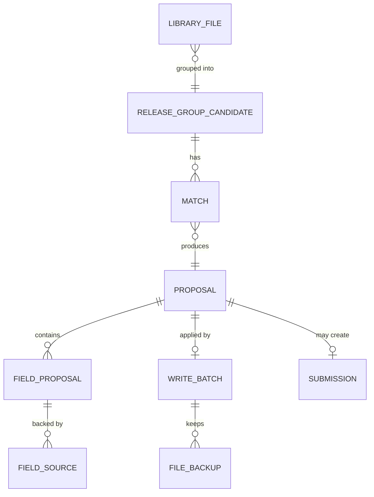
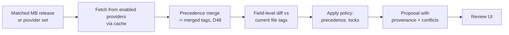

# Tagmonia — Architecture

> **Tags in harmony.** A self-hosted web app that identifies music files, gathers metadata from several providers, merges it with per-field provenance, writes Picard-compatible tags, and helps submit missing releases to MusicBrainz.

| | |
|---|---|
| Status | Draft 1, design baseline for implementation |
| Audience | Maintainer, and the Claude Code agent implementing it |
| Last updated | 2026-11-23 (Phase 0 findings: D7–D15) |

This document is the source of truth for design decisions. When implementation reveals that a decision is wrong, update this file in the same pull request as the code change, and record the change in [§17 Decision log](#17-decision-log).

---

## Table of contents

1. [Goals and non-goals](#1-goals-and-non-goals)
2. [Users and core workflows](#2-users-and-core-workflows)
3. [System overview](#3-system-overview)
4. [Technology stack](#4-technology-stack)
5. [Repository layout](#5-repository-layout)
6. [Domain model](#6-domain-model)
7. [Library scanning](#7-library-scanning)
8. [Identification and matching](#8-identification-and-matching)
9. [Provider layer](#9-provider-layer)
10. [Merge and conflict model](#10-merge-and-conflict-model)
11. [Tag reading and writing](#11-tag-reading-and-writing)
12. [MusicBrainz submission (seeding)](#12-musicbrainz-submission-seeding)
13. [Music server integration](#13-music-server-integration)
14. [Security](#14-security)
15. [Deployment](#15-deployment)
16. [Implementation roadmap](#16-implementation-roadmap)
17. [Decision log](#17-decision-log)
18. [Open questions](#18-open-questions)
19. [References](#19-references)

---

## 1. Goals and non-goals

### Goals

- **G1 — Correct identification.** Every release in the library is matched to a specific MusicBrainz release (edition), not just an album title.
- **G2 — Multi-provider enrichment.** Combine MusicBrainz with other providers (Discogs, Deezer, iTunes, Bandcamp, Beatport, Tidal, Spotify, YouTube) to fill gaps and expose disagreements.
- **G3 — Provenance.** Every proposed value records which provider(s) supplied it. The user can see why a value was chosen.
- **G4 — Human review before writes.** Nothing is written below a confidence threshold without approval. Every write is reversible.
- **G5 — Music-server compatibility.** Tags written are compatible with how MusicBrainz Picard writes them, so Navidrome and Jellyfin read them correctly (multi-valued artists, MBIDs, M4A atoms, OGG cover art).
- **G6 — Contribute back.** When a release is missing from MusicBrainz, build it from other providers and seed the MusicBrainz release editor so the user can submit it.
- **G7 — Homelab-first operations.** One Docker image, one mounted music volume, authentication on by default, works on ARM NAS devices.

### Non-goals (v1)

- Playing music or replacing Navidrome or Jellyfin.
- Downloading music from any source.
- Fully automatic, unattended submission to MusicBrainz. Submission always goes through the user's own browser session.
- Multi-tenant SaaS hosting. Tagmonia is a single-household app; multiple local users are a later feature.
- Editing video files, podcasts or audiobooks.

### Supported audio formats (v1)

| Format | Container / tag system | Notes |
|---|---|---|
| FLAC | Vorbis comments + PICTURE block | Native multi-value via repeated fields |
| OGG Vorbis | Vorbis comments | Cover art in `METADATA_BLOCK_PICTURE` (base64 FLAC picture block) |
| Opus (`.opus`) | Vorbis comments (OpusTags) | Same as OGG Vorbis |
| MP3 | ID3v2.4 (read ID3v2.3 and v1) | Multi-value via null-separated frames and `TXXX` frames as Picard does |
| M4A / AAC / ALAC | MP4 atoms | Multi-value must be stored inside **one** atom, not duplicated atoms |

---

## 2. Users and core workflows

**Personas**

- *Homelab user*: runs Navidrome or Jellyfin on a NAS, wants a clean library without installing desktop software.
- *Collector*: cares about the exact edition (label, catalog number, barcode, country, media), classical credits, and source provenance.

**Workflows**

| ID | Workflow | Outcome |
|---|---|---|
| W1 | Scan library | Files indexed, grouped into release candidates, current tags read |
| W2 | Identify release | Candidate matched to a MusicBrainz release with a confidence score |
| W3 | Enrich and review | Merged proposal shown per field with sources and conflicts; user approves, edits or locks fields |
| W4 | Write tags | Backup taken, tags written atomically, music server rescan triggered |
| W5 | Undo | Any write batch restored from its backup |
| W6 | Release missing on MusicBrainz | Data aggregated from other providers, duplicate check, release editor seeded in a new tab; on return, MBIDs written to files |
| W7 | Inbox / watch folder | New arrivals detected and queued for W2 to W4 |

---

## 3. System overview


Key properties:

- **Single process.** The API server and the workers run in one Deno process. Long work runs in the job queue, never in a request handler.
- **Database-backed state.** Jobs, proposals, decisions and write backups live in SQLite, so restarts resume cleanly.
- **Provider responses are cached as snapshots**, so a proposal can be re-derived and edit notes can cite what was seen at the time.
- **The browser, not the server, talks to the MusicBrainz release editor.** The server never holds MusicBrainz credentials.

---

## 4. Technology stack

| Concern | Choice | Rationale |
|---|---|---|
| Runtime | **Deno 2** (TypeScript) | Same runtime as Harmony, whose provider, merge and seeding code we reuse; single language across UI and server; `deno compile` and good Docker story |
| HTTP framework | **Hono** | Small, typed, runs on Deno, easy middleware for auth and CSRF |
| Frontend | **Preact + Vite**, TypeScript, built to static files served by the API | Small bundle; no SSR needed for a self-hosted tool |
| Database | **SQLite** in WAL mode, file at `/config/tagmonia.db` | Zero-ops for homelab users; one writer is enough |
| Migrations | Plain numbered SQL files in `server/db/migrations`, applied at startup | Transparent and reviewable |
| Metadata aggregation | **Harmony** (MIT, `kellnerd/harmony`) providers, harmonized types, merge and seeding modules | Avoid re-implementing a dozen providers and the MusicBrainz seeding format |
| Fingerprinting | **Chromaprint `fpcalc`** binary + AcoustID web API | Standard, used by Picard and beets |
| Tag I/O | Behind the `TagIO` interface; implementation chosen by spike in Phase 0 (see [§11.4](#114-tagio-implementation-spike)) | Tag-writing correctness is the riskiest part; decide with tests, not assumptions |
| Containers | Multi-arch image (amd64, arm64) | NAS devices are often ARM |

### 4.1 Reusing Harmony

Harmony is TypeScript; most modules use web standards and run outside its Fresh server. Its relevant parts:

- `providers/` — one provider per subfolder, base classes in `providers/base.ts`, registry in `providers/registry.ts`
- `harmonizer/types.ts` and `harmonizer/merge.ts` — harmonized release type and merge algorithm
- `musicbrainz/seeding.ts` — release editor seeding
- `musicbrainz/mbid_mapping.ts` — resolving external IDs and URLs to MBIDs
- `lookup.ts` — combined lookup by GTIN, URL or provider ID

**Integration rules**

1. Vendor Harmony as a **git submodule pinned to a specific commit** at `vendor/harmony`. Never track a moving branch.
2. Import only from the modules listed above, through a thin adapter in `server/providers/harmony_adapter.ts`. No other code imports Harmony directly.
3. Do not import Harmony's `server/` (Fresh) code.
4. Keep Harmony's MIT license notice in `THIRD_PARTY_NOTICES.md` and in the built image.
5. Upstream bug fixes to Harmony when possible instead of patching the vendored copy. If a local patch is unavoidable, keep it as a `.patch` file applied at build time and list it in the decision log.
6. **Phase 0 must verify** that the listed modules import cleanly under Deno without the Fresh server and that the provider credentials they need can be supplied from Tagmonia's config. If not, record the gap and adapt.

---

## 5. Repository layout

```text
tagmonia/
├── docs/
│   └── ARCHITECTURE.md        # this file
├── CLAUDE.md                  # agent instructions (root so Claude Code loads it automatically)
├── LICENSE                    # GPL-3.0 (D17)
├── README.md
├── THIRD_PARTY_NOTICES.md
├── deno.json                  # tasks, imports, compiler options
├── Dockerfile
├── docker-compose.example.yml
├── docker/
│   └── dev.Dockerfile         # dev/test toolchain image (D13)
├── scripts/
│   ├── dk                     # run a command in the dev container
│   ├── gen_fixtures.sh        # generate tests/fixtures/audio
│   └── gen_library.ts         # synthetic library in dev/music for scale checks
├── vendor/
│   └── harmony/               # git submodule, pinned commit
├── server/
│   ├── main.ts                # boot: config, migrations, queue, HTTP
│   ├── config.ts              # env, validated
│   ├── settings.ts            # /config/settings.json, validated
│   ├── log.ts                 # structured logging with secret redaction (§14.3)
│   ├── auth/                  # Argon2id passwords, sessions, login throttle, admin bootstrap
│   ├── fs/
│   │   └── safe_path.ts       # music-root confinement (§14.4)
│   ├── http/
│   │   ├── app.ts             # Hono app, middleware order
│   │   ├── auth.ts            # sessions, login, CSRF
│   │   └── routes/            # one file per resource
│   ├── db/
│   │   ├── db.ts              # node:sqlite, WAL, migration runner (D19)
│   │   ├── migrations/        # 0001_init.sql, ...
│   │   └── repo/              # typed data-access functions
│   ├── jobs/
│   │   ├── queue.ts           # persistent queue, retries, cancellation
│   │   ├── scan.ts
│   │   ├── identify.ts
│   │   ├── enrich.ts
│   │   └── write.ts
│   ├── scanner/               # walk.ts, group.ts, scan.ts (§7)
│   ├── identify/              # candidate search, scoring, fingerprint
│   ├── providers/
│   │   ├── harmony_adapter.ts
│   │   ├── ratelimit.ts       # per-provider token buckets
│   │   ├── youtube.ts         # Tagmonia-owned provider (see §9.5)
│   │   └── registry.ts
│   ├── merge/                 # proposal building, policy, locks
│   ├── tagio/
│   │   ├── types.ts           # TagIO interface, canonical tag model
│   │   ├── mapping.ts         # canonical field -> per-format keys
│   │   ├── atomic.ts          # temp copy, fsync, rename (§11.1)
│   │   ├── verify.ts          # round-trip verification (§11.3)
│   │   ├── schema.ts          # runtime validation of sidecar output
│   │   ├── sniff.ts           # magic-byte format check (§7)
│   │   └── impl/
│   │       ├── mutagen.ts           # production TagIO: client for the sidecar (D7)
│   │       ├── mutagen_sidecar.py   # Python/mutagen process, NDJSON over stdio
│   │       └── taglib_wasm.ts       # spike implementation, kept for re-evaluation
│   ├── musicbrainz/
│   │   ├── seed.ts            # wraps Harmony seeding, adds edit note
│   │   └── callback.ts        # redirect_uri handler
│   └── integrations/
│       ├── navidrome.ts
│       └── jellyfin.ts
├── web/                       # Preact SPA
│   ├── src/
│   │   ├── pages/             # Library, Review, Providers, Submit, Settings
│   │   ├── components/
│   │   └── api.ts             # typed client generated from server types
│   └── vite.config.ts
├── shared/
│   └── types.ts               # API DTOs shared by server and web
└── tests/
    ├── fixtures/
    │   ├── audio/             # generated test files (see §11.5), gitignored
    │   ├── generate_audio.py  # reference writer (ffmpeg + mutagen)
    │   ├── fixture_tags.json  # canonical tags the fixtures carry
    │   ├── picard_tag_map.tsv # extract of Picard's tag mapping table
    │   └── snaps/             # recorded provider responses
    ├── helpers/               # replaying fetch, shared test utilities
    ├── tagio/                 # conformance suite, raw inspector
    ├── merge/
    ├── identify/
    └── e2e/
```

---

## 6. Domain model

### 6.1 Entities



| Entity | Purpose | Key columns |
|---|---|---|
| `library_file` | One audio file on disk | `id`, `path` (relative to music root), `size`, `mtime`, `format`, `duration_ms`, `fingerprint`, `acoustid_id`, `current_tags` (JSON), `pictures` (JSON metadata, no bytes), `read_error`, `candidate_id`, `scanned_at` |
| `candidate` | A group of files believed to form one release (usually a folder) | `id`, `group_key` (stable across rescans), `folder`, `hint_artist`, `hint_album`, `hint_mbid`, `hint_track_count`, `content_hash`, `status` (`new`, `changed`, `identifying`, `matched`, `needs_review`, `no_match`, `error`), `identified_at`, `identified_hash`, `identify_error`, `unexamined_editions` (JSON, for the edition picker); member files point to it via `library_file.candidate_id` |
| `match` | A scored MusicBrainz release for a candidate; an identify run replaces the candidate's matches | `candidate_id`, `rank`, `release_mbid`, `release_group_mbid`, `score`, `method` (`existing_mbid`, `barcode`, `catno`, `text`, `fingerprint`, `manual`), `signals` (JSON, per signal), `track_mapping` (JSON), `summary` (JSON, for the edition picker), `snapshot_id` |
| `proposal` | Merged metadata for one candidate + chosen match | `id`, `candidate_id`, `release_mbid` (nullable for not-in-MB), `state` (`draft`, `needs_review`, `approved`, `written`, `discarded`), `created_at` |
| `field_proposal` | One canonical field of one file (D40: per file, since writes are per file; release-level fields repeat on each file) | `proposal_id`, `file_id`, `field`, `current_value`, `proposed_value`, `status` (`unchanged`, `changed`, `added`), `decision` (`auto`, `accepted`, `edited`, `kept_current`), `edited_value`, `locked`, `origin` (whose value is proposed), `conflict`, `resolved_from` (D48) |
| `field_source` | Provenance for a field value | `field_proposal_id`, `provider`, `value`, `snapshot_id`, `agrees_with_proposed` |
| `write_batch` | One user-approved write operation | `id`, `proposal_id`, `started_at`, `finished_at`, `status`, `error` |
| `file_backup` | Pre-write snapshot for undo, one per file (or folder image) | `write_batch_id`, `file_id`, `path`, `kind` (`tags`, `folder_image`), `tags_before`, `change`, `tags_after` (JSON), `pictures_before`, `pictures_after` (JSON refs to `/config/backups/pictures/<sha256>.bin`, D49), `status`, `error` |
| `cover_proposal` | The release's proposed front cover, decided once for every file (D49) | `proposal_id`, `mode`, `source`, `skipped` (JSON), `embed`, `folder` (JSON: SHA-256, MIME type, size in px and bytes, URL), `embed_status`, `folder_status`, `folder_path`, `folder_current` (SHA-256 the review saw), `decision` (`auto`, `accepted`, `kept_current`) |
| `submission` | A MusicBrainz seeding attempt | `id`, `proposal_id`, `seed_payload` (JSON), `state` (`seeded`, `returned`, `abandoned`), `release_mbid` |
| `field_lock` | User's standing "never change this" rule | `scope` (`file`, `release`, `global_field`), `target`, `field` |
| `job` | Queue entry | `id`, `kind`, `payload`, `state`, `attempts`, `run_after`, `error` |
| `snapshot` | Cached provider response | `id`, `provider`, `request_key`, `status`, `fetched_at`, `body_path`, `size` |

### 6.2 Canonical tag model

All internal code uses one canonical model, independent of file format. Names follow Picard's internal tag names so the mapping to formats can follow Picard's documentation.

```ts
// server/tagio/types.ts (sketch)
export type Multi = string[];          // always arrays for multi-valued fields

export interface CanonicalTags {
  // track-level
  title?: string;
  artist?: string;                     // display credit, e.g. "Alice feat. Bob"
  artists?: Multi;                     // individual names
  artistsort?: string;
  tracknumber?: number;
  totaltracks?: number;
  discnumber?: number;
  totaldiscs?: number;
  isrc?: Multi;
  composer?: Multi;
  lyricist?: Multi;
  conductor?: Multi;
  performer?: Record<string, Multi>;   // role -> names
  work?: string;
  arranger?: Multi;                    // classical fields: §6.3
  composersort?: Multi;
  movement?: string;
  movementnumber?: number;
  movementtotal?: number;
  showmovement?: number;               // 1 when movement fields are set
  musicbrainz_recordingid?: string;
  musicbrainz_trackid?: string;        // release-track MBID (Picard's name; see D8)
  musicbrainz_artistid?: Multi;
  musicbrainz_workid?: Multi;
  acoustid_id?: string;

  // release-level (written to every track of the release)
  album?: string;
  albumartist?: string;
  albumartists?: Multi;
  albumartistsort?: string;
  date?: string;                       // YYYY, YYYY-MM or YYYY-MM-DD
  originaldate?: string;
  label?: Multi;
  catalognumber?: Multi;
  barcode?: string;
  media?: string;
  releasecountry?: string;
  releasestatus?: string;
  releasetype?: Multi;
  script?: string;
  language?: string;
  genre?: Multi;
  musicbrainz_albumid?: string;
  musicbrainz_releasegroupid?: string;
  musicbrainz_albumartistid?: Multi;

  // provider IDs (custom tags, see §11.2)
  discogs_release_id?: string;
  deezer_album_id?: string;
  // ...one per enabled provider
}

export interface Picture {
  type: "front" | "back" | "other";
  mime: string;                        // any image/* read from files; Tagmonia writes JPEG/PNG (D11)
  data: Uint8Array;
  description?: string;
}
```

### 6.3 Classical music (D28)

Classical support is in scope for v1 and goes beyond basic credits. Every field below has a Picard mapping (`tests/fixtures/picard_tag_map.tsv`), so files stay readable by Picard, Navidrome and Jellyfin.

**Canonical fields added to §6.2** (track-level):

| Field | Source in MusicBrainz | Notes |
|---|---|---|
| `composer`, `composersort` | Work → composer relationship | Sort name from the artist entity |
| `lyricist` | Work → lyricist/librettist relationships | |
| `arranger` | Recording or work → arranger/orchestrator relationships | Multi |
| `conductor` | Recording → conductor relationship | Already in §6.2 |
| `performer` | Recording → performer/instrument/vocal relationships | Role keys as Picard writes them, e.g. `piano`, `soprano vocals`, `orchestra`, `choir`, `chorus master` |
| `work`, `musicbrainz_workid` | Recording → performance → work; top-level parent work for `work` | `work` is the whole piece (e.g. "Symphony No. 5 in C minor, Op. 67") |
| `movement`, `movementnumber`, `movementtotal` | The performed work's position among the parent work's parts (part-of relationship and its order) | Only set when the parent work has ordered parts |
| `showmovement` | Derived | `1` when movement fields are set, so players that support it show work + movement |

**Rules**

- Fetch release data with recording-level and work-level relationships and the parent works, so one release lookup plus parent-work lookups is enough; every request goes through the MusicBrainz rate limiter and the snapshot cache.
- Never rewrite `title`: the MusicBrainz track title stays as is. Work and movement live in their own fields.
- Classical track titles vary a lot between releases, so identification relies more on durations, track count and fingerprints for these releases (§8.1 weights are tuned on fixtures that include classical releases).
- The review UI groups classical credits (work, movement, composer, performers, conductor) so they can be checked at a glance.

---

## 7. Library scanning

**Input:** the music root (`/music` in the container). Paths stored in the database are always **relative** to the root.

**Steps**

1. Walk the tree, skipping hidden entries, `@eaDir` (Synology), `#recycle`, configured ignore globs (`settings.json` → `scanner.ignore`) and all symlinks (D21).
2. For each audio file (by extension and magic bytes), compare `size` + `mtime` with the database. Unchanged files are skipped.
3. Read tags and technical properties through `TagIO.read`. Store the canonical tags as `current_tags`.
4. **Grouping into candidates:**
   - Primary: files in the same folder that share `album` + `albumartist` (or `musicbrainz_albumid` when present). The track artist is not part of the key, so compilations stay together (D22).
   - Multi-disc folders (`CD1`, `Disc 2`, ...) under one parent are merged into one candidate when album tags agree.
   - A folder with mixed albums is split by album tag; files with no album tag stay a "loose files" candidate for fingerprinting.
5. Enqueue an `identify` job (§8) for each new or changed candidate (dedupe key `identify:<id>`, so a candidate is never queued twice).

Scanning only reads the library (it runs in read-only mode too). Unreadable files are kept with a `read_error`, so the UI can show them.

**Watch mode (W7):** use `Deno.watchFs` on an optional inbox folder; debounce events for 30 s after the last change before scanning, so partial copies are not processed. Polling fallback every N minutes for network filesystems where inotify does not work (SMB/NFS mounts are common on NAS setups).

---

## 8. Identification and matching

Identification runs in this order and stops at the first confident result:

| Order | Method | When | Notes |
|---|---|---|---|
| 1 | Existing MBIDs | Files already have `musicbrainz_albumid` | Verify the release still exists (it may have been merged; follow redirects) |
| 2 | Barcode / catalog number | Tags contain `barcode` or `catalognumber` | Exact lookup |
| 3 | Text search | Album + artist + track count available | MusicBrainz release search, then score |
| 4 | Fingerprint | Text search weak or tags missing, and an AcoustID key is set | `fpcalc` per file → AcoustID → recordings → releases containing them. Releases most files point at are looked up first; releases found earlier are rescored with the fingerprint signal |
| 5 | Manual | All else fails | User pastes a MusicBrainz, Discogs, Deezer, Bandcamp, ... URL. Until Phase 4 adds the other providers, only MusicBrainz release links (D39) |

### 8.1 Scoring

Each candidate release gets a score from 0 to 1, a weighted sum of:

| Signal | Weight (initial) | How |
|---|---|---|
| Track count match | 0.20 | Files not on the release: none = ×1, one = ×0.5, more = ×0. Tracks missing from the folder cost little: × (0.5 + 0.5 × agreement), where agreement is the files' own "track N **of M**" / "disc N of M" totals against the release's, or the share of the release present when the files declare none (D45) |
| Track durations | 0.25 | Per file, through a tolerance curve (≤ 3 s per track is a strong match), averaged over the files: a track missing from the folder does not count against it (D45) |
| Track titles | 0.20 | Normalized string similarity per position |
| Album title | 0.10 | Normalized similarity |
| Artist credit | 0.10 | Normalized similarity on album artist |
| Fingerprint coverage | 0.15 | Share of files whose AcoustID recordings appear on this release |
| Barcode / catalog number | override | Exact match sets a floor of 0.95 |

Weights live in config and are tuned using a labelled fixture set in `tests/identify/`. Thresholds:

- `score ≥ auto_threshold` (default 0.92) → proposal can be auto-approved **only** if the user enabled auto-approve; otherwise `needs_review`.
- `review_threshold ≤ score < auto_threshold` (default 0.70) → `needs_review`, show top 3 candidates.
- below `review_threshold` → "no confident match", offer manual search and the W6 flow.
- A near-tie with any runner-up (within the edition margin, default 0.03) also means `needs_review`, even above `auto_threshold`.

**Missing evidence (D36).** A signal with no evidence (no fingerprint yet, no album tag, untagged titles) is left out, and the weighted mean is taken over the signals that remain, so a well-tagged album without fingerprints can still reach `auto_threshold`. When the signals present carry less than `minCoverage` (default 0.6) of the total weight, the score is held just below `auto_threshold`: a match on durations alone is never unattended. The barcode/catalog-number floor applies only when the track count is within one.

**Track count** is taken from the track mapping, not raw counts, so an extra file does not make a bonus edition look like an exact match. **Partial albums** (D45): people often keep only part of an album, so tracks missing from the folder are penalised lightly, while files that are not on the release still are heavily; titles and durations are averaged over the files. A file whose title clearly contradicts a track (similarity below 0.3) and whose track number does not agree is not mapped onto it on duration alone; generic titles ("Track 01") contradict nothing. Search hits are pre-ranked with the same count rule. **Misspelt tags:** when phrase searches find nothing, a fuzzy word search follows (D38).

**Lookup budget (D36).** Search hits already carry title, artist credit and track count, so they are pre-ranked on those, and only the best `maxLookupsPerSearch` (default 5) get a full release lookup and a score. Untagged sets are searched by their folder name ("Artist - Album (year)"), which is never used as scoring evidence.

Weights, thresholds and these limits live in `settings.json` under `identify`.

### 8.2 Edition picking

When several releases in the same release group score within 0.03 of each other (common: same album, different countries or pressings), the UI shows an **edition picker** listing country, date, label, catalog number, barcode, media format and track count side by side. Never silently pick one edition for a collector.

The picker's alternatives come from the best release's **release group**, browsed once per identified candidate (up to 300 releases), plus search hits: editions within one track of the best one's count are listed without a full lookup. A result is never `matched` while an unexamined edition with the same track count exists, **unless the files name the edition** (MBID already in the tags, or an exact barcode/catalog-number match): such a *pinned* release ranks above unpinned ones once it reaches `auto_threshold`, and only competes with other pinned releases for ties (D38).

### 8.3 Track mapping

Matching produces an explicit mapping from file to (medium, position). Mapping uses duration and title similarity with the Hungarian algorithm, so files in the wrong order still map correctly. Unmapped files and unmatched release tracks are shown in the review UI.

---

## 9. Provider layer

### 9.1 Interface

Tagmonia wraps every provider (Harmony-backed or its own) behind one interface:

```ts
// server/providers/types.ts (sketch)
export interface ProviderInfo {
  id: string;                    // "musicbrainz", "discogs", ...
  displayName: string;
  requiresCredentials: boolean;
  tier: "core" | "enrichment" | "optional";
  rateLimit: { requests: number; perMs: number };  // from config, see §9.3
}

export interface Provider {
  info: ProviderInfo;
  lookupByUrl?(url: string): Promise<HarmonizedRelease | null>;
  lookupByGtin?(gtin: string, region?: string): Promise<HarmonizedRelease[]>;
  lookupById?(id: string): Promise<HarmonizedRelease | null>;
  search?(q: { artist?: string; album?: string; trackCount?: number }): Promise<HarmonizedRelease[]>;
}
```

`HarmonizedRelease` is Harmony's harmonized release type, re-exported through the adapter so the rest of Tagmonia does not depend on Harmony's file layout.

### 9.2 Provider tiers

| Tier | Providers | Default | Credentials |
|---|---|---|---|
| Core | MusicBrainz, Cover Art Archive, AcoustID | On | AcoustID application API key (free, user-supplied) |
| Enrichment | Discogs, Deezer, iTunes | On (Discogs only if credentials are set) | Discogs consumer key + secret (what Harmony's provider uses, D12) |
| Optional | Bandcamp, Beatport, Tidal, Spotify | Off | Per provider; Spotify and Tidal need app credentials. Bandcamp and Beatport have no official API; Harmony reads their public pages, so they are opt-in only and never on by default (D16) |
| Optional, evidence only | YouTube | Off | YouTube Data API key |

Commercial APIs change without notice (Spotify has removed endpoints that Harmony relied on). Every optional provider must degrade to "unavailable" without breaking a lookup.

### 9.3 Rate limiting and politeness

- One **token bucket per provider**, configured in `settings.json`. Defaults must be conservative and documented with the date they were checked.
- **MusicBrainz:** at most 1 request per second on average, and every request sends a meaningful `User-Agent`, `Tagmonia/<version> ( https://github.com/cdalamagkas/tagmonia )` (`server/version.ts`, D18). Allow pointing the base URL at a local MusicBrainz mirror for large libraries.
- Retries: exponential backoff with jitter on 429/503; respect `Retry-After`.
- All provider calls go through the snapshot cache (§9.4) first.

> Verify each provider's current published limits during Phase 2 and record them in the decision log. Do not hard-code numbers from memory.

MusicBrainz limits were checked on 2026-11-23 (D32). Tagmonia talks to MusicBrainz through its own WS/2 client (`server/providers/musicbrainz/`, D31), not Harmony's. A local mirror is set with `providers.musicbrainz.baseUrl` in `settings.json`; only a mirror may set `requestsPerSecond` above 1.

### 9.3.1 Finding the release on other providers (D47)

For the release a proposal is built from, each enabled enrichment provider (Deezer, iTunes, Discogs) is looked up through Harmony: by the release's own MusicBrainz URL relationship when it has one, otherwise by barcode. Details found against the live services:

- A barcode miss is retried with the barcode's other spellings (without leading zeros, as 13 and 12 digits): MusicBrainz often stores the 14-digit GTIN where Discogs keeps 12 or 13.
- A provider that has moved a release (Deezer serving another album ID than the linked one, which Harmony refuses) is looked up once more at the new address.
- A result whose track count differs from the release is kept as **another edition** (e.g. a 16-track Japanese deluxe for a 13-track release) and never used for tags.
- iTunes and Deezer are asked for the release's country first, then US and GB.
- No outcome fails the proposal: each provider ends as found, another edition, not found, skipped (turned off, not set up, nothing to look up) or error, stored per proposal in `provider_release`.

Harmony's Discogs provider sends its credentials in an `Authentication` header; Discogs documents `Authorization`. As of 2026-11-25 Discogs answers lookups and barcode searches without authentication, so nothing breaks; Harmony's requests are simply anonymous (25 per minute, which Harmony already respects). Worth reporting upstream.

### 9.4 Snapshot cache

Harmony's base provider caches responses as snapshots keyed by request URL and timestamp. Tagmonia keeps this behaviour, with storage under `/config/snaps/`:

- Bodies are stored as files under `/config/snaps/<provider>/`, indexed by the `snapshot` table (provider, request URL, HTTP status, time). A refetch adds a row; it never overwrites one, so old proposals keep their evidence.
- Responses are validated before they are cached, so a malformed or truncated response is never served from the cache. 404s are cached, so a missing MBID is not asked again on every scan.
- Default TTL: 30 days for release lookups, 1 day for searches.
- A proposal stores the snapshot IDs it was built from, so the review UI and the MusicBrainz edit note can show exactly what each provider returned.
- `Settings → Cache` shows size and offers purge by provider or age.

### 9.5 YouTube provider (Tagmonia-owned)

Harmony has no merged YouTube Music provider, so Tagmonia implements a minimal one.

- **Official YouTube Data API only.** No unofficial or internal YouTube Music APIs in the default build, because of terms-of-service risk and breakage.
- **Input:** a video or playlist URL pasted by the user. Avoid `search.list`, which has a small separate daily quota by default; `videos.list` and `playlistItems.list` are cheap.
- **Extraction:** parse auto-generated "Provided to YouTube by ..." descriptions for label, ℗/© line and "Released on" date; playlist order for track sequence; durations from `contentDetails`.
- **Trust level:** evidence only. YouTube values can fill gaps and corroborate, but cannot by themselves set the tracklist, artist credits or release type when another provider disagrees. YouTube exposes no barcode.

---

## 10. Merge and conflict model

### 10.1 Pipeline



### 10.2 Per-field provenance

For every canonical field, the proposal records every provider's value (normalized) and which ones agree with the proposed value. The UI shows chips per source and a conflict badge when sources disagree after normalization.

**Normalization before comparison** (comparison only; the proposed value keeps its original form). Two strengths (D43):

- **Deciding whether a field changes** ignores only what a reader cannot see: Unicode NFC, trimmed whitespace, collapsed internal spaces. Case and punctuation differences *are* changes, so MusicBrainz's exact spelling is proposed as Picard writes it (`is this it` → `Is This It`, `Don't` → `Don’t`); the user can keep or edit any field in the review.
- **Deciding whether providers agree with each other** (conflicts, Phase 4) also ignores case and treats typographic quotes and dashes as their ASCII forms.
- Both: dates compared at the precision both sides have (`2019` agrees with `2019-05-03`); barcodes compared as digits only, with leading zeros normalized (UPC-A vs EAN-13).

### 10.3 Precedence policy

Default policy, configurable per field in settings:

| Field group | Precedence | Reason |
|---|---|---|
| Identity: MBIDs, tracklist, track artists, release artist | MusicBrainz only | Music servers key on MusicBrainz data |
| Release date | MusicBrainz → Deezer → iTunes → Discogs | Streaming stores often have precise day-level dates when MB has only a year |
| Original date | MusicBrainz (release group first release) | |
| Label, catalog number, barcode, country, media | MusicBrainz → Discogs | Discogs is strongest for physical pressings |
| Genre | **MusicBrainz genres** by default (D27): release-group and release genres merged by vote count, up to 5, written to `genre`. Configurable: Discogs genres/styles, or none | Maintainer choice; MusicBrainz genres are a curated list, not free-form tags |
| Cover art | Cover Art Archive → iTunes → Deezer → Discogs (front cover; store order = their usual image size) | Resolution, size and source shown in the review; written per the cover setting (D49) |
| ISRC | MusicBrainz → Deezer → iTunes, per track; filled only, never a conflict | A recording legitimately has several ISRCs. Spotify joins in Phase 6 |
| Provider IDs | Each provider for its own ID | |

**Rules**

1. A **locked** field is never changed. Locks are set per file, per release, or globally per field.
2. A field whose current value already agrees with the proposed value (after normalization) is marked "unchanged" and not rewritten.
3. If the highest-precedence provider has no value, fall through to the next one, and mark the field as "filled by fallback" in the UI.
4. When two or more providers disagree and none is authoritative for the field, mark the field as a **conflict**; the proposal cannot be auto-approved while it has unresolved conflicts.

**As implemented (D48).** `server/proposal/merge.ts` applies the table to MusicBrainz's tags and the providers whose release matched (`found`, same track count; another edition never contributes; tracks align by position). Conflicts arise only between MusicBrainz and Discogs: on release date (a different year) and on label, catalog number and barcode between MusicBrainz and Discogs; catalog numbers compare like identifiers (`2542105` = `2542 105`). A year-only date is refined by a full date for the same year from any listed provider (Deezer and iTunes only refine: their other years are kept as sources, not conflicts), and that counts as a change worth writing; a file's more precise date is never cut back. Each field row stores its `origin` and `conflict`; every source's value is kept with whether it agrees. A conflict is settled by any decision (picking a source's value, keeping, editing) or a lock; `POST /api/proposals/:id/write` answers 409 while one is unsettled.

### 10.4 "Not in MusicBrainz" proposals

When no MusicBrainz release matches (W6), the proposal is built from the other providers via Harmony's merge, with `release_mbid = null`. It can be written to files without MBIDs (user's choice), and it is the input to seeding (§12).

---

## 11. Tag reading and writing

### 11.1 TagIO interface

```ts
// server/tagio/types.ts (sketch)
export interface TagIO {
  // pictureData: false returns picture type/mime/size without the bytes (the scanner's case, D24)
  read(path: string, options?: { pictureData?: boolean }): Promise<{ tags: CanonicalTags; pictures: Picture[]; audio: AudioProps; raw: RawTagDump }>;
  write(path: string, change: TagChange): Promise<void>;
}

export interface TagChange {
  set: Partial<CanonicalTags>;     // fields to set (arrays replace wholesale)
  remove: (keyof CanonicalTags)[]; // fields to delete
  pictures?: Picture[];            // replace all pictures when present
}
```

`write` must be **atomic**: write to a temporary file in the same directory, `fsync`, then rename over the original. Preserve the original file's permissions and ownership. Never re-encode audio.

### 11.2 Format mapping

Follow MusicBrainz Picard's tag mapping table as the authoritative reference (link in [§19](#19-references)). The table below lists the high-risk fields; `server/tagio/mapping.ts` contains the full mapping and the conformance tests in `tests/tagio/` must assert it.

| Canonical | ID3v2.4 | Vorbis comment (FLAC/OGG/Opus) | MP4 |
|---|---|---|---|
| `title` | `TIT2` | `TITLE` | `©nam` |
| `artist` | `TPE1` | `ARTIST` | `©ART` |
| `artists` | `TXXX:ARTISTS` (multi) | `ARTISTS` (repeated) | `----:com.apple.iTunes:ARTISTS` (one atom, multiple values) |
| `albumartist` | `TPE2` | `ALBUMARTIST` | `aART` |
| `album` | `TALB` | `ALBUM` | `©alb` |
| `tracknumber` / `totaltracks` | `TRCK` (`n/total`) | `TRACKNUMBER`, `TRACKTOTAL` **and** `TOTALTRACKS` | `trkn` |
| `discnumber` / `totaldiscs` | `TPOS` | `DISCNUMBER`, `DISCTOTAL` **and** `TOTALDISCS` | `disk` |
| `isrc` | `TSRC` | `ISRC` | `----:com.apple.iTunes:ISRC` |
| `musicbrainz_albumid` | `TXXX:MusicBrainz Album Id` | `MUSICBRAINZ_ALBUMID` | `----:com.apple.iTunes:MusicBrainz Album Id` |
| `musicbrainz_recordingid` | `UFID:http://musicbrainz.org` | `MUSICBRAINZ_TRACKID` | `----:com.apple.iTunes:MusicBrainz Track Id` |
| `musicbrainz_trackid` (release track) | `TXXX:MusicBrainz Release Track Id` | `MUSICBRAINZ_RELEASETRACKID` | `----:com.apple.iTunes:MusicBrainz Release Track Id` |
| `work` | `TXXX:WORK` | `WORK` | `©wrk` |
| `originaldate` | `TDOR` | `ORIGINALDATE` | `----:com.apple.iTunes:originaldate` (D9) |
| `performer` | `TMCL` (role, name pairs) | `PERFORMER=Name (role)` | not stored, as in Picard (D9) |
| `arranger` | `TIPL` role `arranger`, sharing the frame with producer, engineer and mix credits, which a write keeps | `ARRANGER` | `----:com.apple.iTunes:arranger` (Picard's fallback naming, D9) |
| `composersort` | `TSOC` | `COMPOSERSORT` | `soco` |
| `movement` | `MVNM` | `MOVEMENTNAME` | `©mvn` |
| `movementnumber` / `movementtotal` | `MVIN` (`n/total`) | `MOVEMENT`, `MOVEMENTTOTAL` | `©mvi`, `©mvc` (integer atoms; Picard's docs table says `mvi`/`mvc`, D35) |
| `showmovement` | `TXXX:SHOWMOVEMENT` | `SHOWMOVEMENT` | `shwm` (integer atom) |
| `albumartists` | `TXXX:ALBUMARTISTS` | `ALBUMARTISTS` | `----:com.apple.iTunes:ALBUMARTISTS` (not in Picard's table, D8) |
| front cover | `APIC` type 3 | FLAC: `PICTURE` block; OGG/Opus: `METADATA_BLOCK_PICTURE` | `covr` |
| provider IDs | `TXXX:DISCOGS_RELEASE_ID`, ... | `DISCOGS_RELEASE_ID`, ... | `----:com.apple.iTunes:DISCOGS_RELEASE_ID`, ... |

> Note that Picard's naming is historical: Vorbis `MUSICBRAINZ_TRACKID` holds the **recording** MBID, while `MUSICBRAINZ_RELEASETRACKID` holds the release-track MBID. Every row was verified against the Picard documentation in Phase 0 (2026-11-23): `tests/tagio/mapping.test.ts` checks `mapping.ts` against an extract of Picard's table (`tests/fixtures/picard_tag_map.tsv`), and the conformance tests are the final word. MP4 `covr` has no picture-type field, so MP4 covers always read back as front covers (D10).

**Multi-value rules**

- `artist` holds the display credit as one string (e.g. "Alice feat. Bob"); `artists` holds the individual names. Write both, as Picard does.
- ID3v2.4: multiple values are null-separated within one frame. Offer an ID3v2.3 compatibility option that joins with `/` or a configured separator (v2.3 has no native multi-value).
- MP4: all values in **one** freeform atom. Duplicate atoms make Navidrome show only one artist.
- Never split on `&`, `/`, `,` when **reading** unless the user enables a separator rule; names like "AC/DC" and "Simon & Garfunkel" break otherwise.

### 11.3 Write procedure

1. Re-read the file and compare with the state the proposal was built from. If tags changed on disk since then, abort that file and mark the proposal stale.
2. Store `file_backup` (tags and pictures before) in the database.
3. Apply `TagChange` atomically (§11.1).
4. Re-read and verify the written fields round-trip. On mismatch, restore from backup and record the error.
5. Mark the batch complete; enqueue a music-server rescan (§13).

Undo (W5) re-applies `tags_before` and `pictures_before` through the same atomic write path.

Details (D41): the stale check compares, per file, every field about to change with the value the review saw; a mismatch skips that file only. The backup row is stored before the write, so an interrupted batch still leaves the original tags. A restore after a failed verify is itself verified; if it fails too, the file is reported as failed with its original tags kept in the backup, never as restored. After each file, the database gets its new size, mtime and tags, and the release's content hash is recomputed exactly as the scanner does, so the next scan does not treat a written release as changed. Writes and undos are never retried, and one runs per release at a time. Undo puts back each changed field's previous value and removes fields the write added; a file whose written fields were changed by something else since is left alone. **Pictures (D49).** When the cover changes, each file's pictures are read with their bytes, stored in a content-addressed backup store (`/config/backups/pictures/<sha256>.bin`; a cover shared by every track is kept once) and referenced from `pictures_before`. The write replaces only the front cover and keeps every other picture (MP4 `covr` has no types, so there all pictures are replaced, D10). Pictures are verified by content hash, in any order, since formats store them in their own order (ID3 sorts frames by key). Undo restores the pictures exactly, unless they changed since the write. The folder image (`cover.jpg`/`cover.png`) gets its own backup row: it is written atomically, refused when it changed since the review, and undo puts the old file back or removes the one Tagmonia created, never someone else's.

Optional, off by default: **rename/move files** using a template (e.g. `{albumartist}/{date:4} - {album}/{discnumber}-{tracknumber:02} {title}`). Renames are journaled the same way as tag writes so they can be undone.

### 11.4 TagIO implementation spike

Phase 0 evaluates candidate implementations against the conformance suite (§11.5) and picks one:

| Option | Description | Watch for |
|---|---|---|
| A | A TagLib-based library usable from Deno (a WebAssembly build of TagLib, or `node-taglib-sharp` via Deno's npm compatibility) | M4A multi-value atoms, OGG/Opus pictures, ID3v2.4 multi-value frames |
| B | A small Python sidecar using **mutagen**, called over a local Unix socket or stdin/stdout JSON | Adds Python to the image, but mutagen is the most battle-tested tag library |

**Decision rule:** choose the first option that passes 100% of the conformance suite on all five formats. If A fails any test that matters for Navidrome/Jellyfin and the failure cannot be fixed quickly, choose B. Record the result in the decision log. Reading for the scanner may use a faster read-only library if it passes the read half of the suite.

**Result (Phase 0, 2026-11-23): option B, the mutagen sidecar (D7).** taglib-wasm 2.4.1 (TagLib 2.3.2) read every fixture correctly but failed 15 of 46 conformance steps on writes; mutagen passed all 46 plus the crash test. The sidecar is a long-lived `python3 -I` process speaking newline-delimited JSON on stdio. It receives `mapping.ts` at start-up, so the mapping has one source of truth, and only ever edits a temp copy; `atomic.ts` does the copy, fsync, mode/owner restore and rename.

### 11.5 Conformance test suite

Fixtures in `tests/fixtures/audio/` are **generated**, not committed binaries from real music:

- Generate short silent or tone files with `ffmpeg` in each format (FLAC, OGG Vorbis, Opus, MP3, M4A/AAC).
- Seed them with Picard-style tags and pictures using a reference writer (mutagen in a test-only container is fine).

Required test cases:

1. Round-trip every canonical field in every format.
2. Multi-value `artists` with 3 names, including names containing `&` and `/`.
3. M4A: multi-value stored in a single atom (inspect raw atoms).
4. OGG/Opus: front cover written as `METADATA_BLOCK_PICTURE`, readable after round-trip.
5. Unknown and custom tags already in the file are preserved after a write.
6. Unicode: Greek, Japanese, combining characters, emoji in titles.
7. Atomicity: a simulated crash mid-write leaves the original file intact.
8. Optional integration test: run Navidrome in Docker against the fixtures and assert via its API that multi-artist tracks show all artists. *(Deferred to Phase 3, whose "Done when" already requires a real Navidrome check.)*

Additional cases in the suite: a write changes nothing except the requested fields (raw before/after diff), field removal, `tracknumber` updates keep `totaltracks`, file mode is preserved, and ID3v2.3 is read without splitting `/`-joined values.

---

## 12. MusicBrainz submission (seeding)

MusicBrainz has no API for creating releases. The supported route is **seeding the release editor**: a POST of form fields to `https://musicbrainz.org/release/add`, which the user reviews and submits from their own logged-in account. Tagmonia never sees MusicBrainz credentials, and a person reviews every submission.

### 12.1 Flow


### 12.2 Details

- **Seed building:** reuse Harmony's seeding module on the merged release. It also knows which data can only go into the annotation.
- **Edit note:** list every provider URL used, the Tagmonia version, and a link format that identifies the snapshot timestamp. Keep it factual; MusicBrainz editors rely on edit notes.
- **redirect_uri:** `https://<tagmonia-public-url>/mb/callback?submission=<id>`. MusicBrainz appends `release_mbid`. If the user has no public URL configured, the callback still works because it is opened by the user's own browser on the same network.
- **Callback security:** the `submission` id must belong to the logged-in user and be in state `seeded`; the `release_mbid` is verified by fetching it from the MusicBrainz API before anything is written.
- **Cover art:** cannot be seeded. After the callback, offer a link to the release's "Add cover art" page and show the best image found by providers with its source, so the user can upload it.
- **ISRCs:** offer the follow-up step for ISRC submission (Harmony also links to this). Do not automate it in v1.
- **Never** submit automatically or in bulk. One release, one human review.

### 12.3 Other seedable entities

Artists, labels and standalone recordings can be seeded with GET query parameters. v1 only links to "Add artist" when an artist in the seed has no MBID; full artist seeding is a later feature.

---

## 13. Music server integration

| Server | Action after a write batch | Auth |
|---|---|---|
| Navidrome | Subsonic API `startScan` (and poll `getScanStatus`) | Navidrome user + password or token, stored encrypted (§14.3) |
| Jellyfin | Full re-read of exactly the albums Tagmonia wrote (`POST /Items/{album}/Refresh`, `MetadataRefreshMode=FullRefresh`, `ReplaceAllMetadata=true`, recursive); a library scan for folders Jellyfin does not know yet (D44) | API key: `TAGMONIA_JELLYFIN_KEY` or `_KEY_FILE`, with `TAGMONIA_JELLYFIN_URL` and optional `TAGMONIA_JELLYFIN_LIBRARY` |
| None | Nothing; user's server picks up changes on its own schedule | |

Debounce: at most one rescan request per server per minute, so a large batch does not trigger repeated scans. Written album folders queue in `refresh_pending`; one refresh takes them all, and folders written while it runs are picked up by the same run.

Written folders are matched to Jellyfin albums by the end of the album's path (whole path segments, Windows separators and Unicode forms normalised), so Tagmonia's and Jellyfin's mount points may differ. Only those albums get their metadata replaced from the files; manual edits elsewhere in the Jellyfin library are kept. A plain library scan is not enough: Jellyfin merges the new tags into what it had and keeps values a write or undo removed (checked against 10.11.3).

For development, `docker/jellyfin-dev.compose.yml` runs a throwaway Jellyfin over a test folder and `scripts/dev_jellyfin.ts` sets it up (see the README).

---

## 14. Security

Tagmonia has **read-write access to the user's entire music library** and stores third-party API credentials. Treat it as a sensitive service even on a home network.

### 14.1 Authentication

- **Authentication is mandatory.** On first start, the UI requires creating an admin account (or the admin password is supplied via `TAGMONIA_ADMIN_PASSWORD_FILE`). There is no "auth disabled" mode; for reverse-proxy setups use OIDC or trusted-header mode below.
- Passwords hashed with **Argon2id** via `hash-wasm` (D20): 19 MiB, t=2, p=1 (OWASP minimum); minimum length 10.
- The UI's auth probe `GET /api/auth/session` is public alongside login and setup; it returns only whether setup is required, and the user and CSRF token of the caller's own session (D23).
- Login rate limiting per IP and per account, with exponential delay.
- **Sessions:** random 256-bit IDs; the database stores only their SHA-256. Cookie `HttpOnly`, `SameSite=Lax`, `Secure` when `TAGMONIA_PUBLIC_URL` is https. Idle timeout (default 7 days) and absolute lifetime (default 30 days) set in `settings.json` → `auth`.
- **Optional OIDC** (Authorization Code + PKCE) for users who run an identity provider, with a configurable group/role claim for admin access.
- **Optional trusted-header mode** for users behind an authenticating reverse proxy: disabled by default, only accepted from configured proxy IPs.

### 14.2 Request security

- **CSRF:** synchronizer token for all state-changing API calls, plus `Origin`/`Referer` checks.
- **Content Security Policy:** `default-src 'self'`; images also allowed from configured cover-art hosts or proxied through Tagmonia (preferred, so the browser never talks to third parties directly except for the MusicBrainz seeding tab).
- The seeding form POST to `musicbrainz.org` is the one intentional cross-origin navigation; it opens in a new tab with `rel="noopener noreferrer"`.
- Security headers: `X-Content-Type-Options: nosniff`, `Referrer-Policy: same-origin`, `frame-ancestors 'none'`.

### 14.3 Data protection

- Provider tokens and music-server credentials encrypted at rest with a key derived from `TAGMONIA_SECRET_KEY` (or a key file in `/config` generated on first start, permissions `0600`).
- Secrets never returned by the API after being saved; the UI shows "set" / "not set".
- Implemented in Phase 4 (D46): AES-256-GCM, key derived with HKDF-SHA-256 from `TAGMONIA_SECRET_KEY` or from `/config/secret.key` (32 random bytes, created `0600`, tightened to `0600` if found looser). Each value is bound to its provider and field as additional authenticated data. Environment variables (D37, D44) still win over the store. A value that cannot be decrypted (the key changed) is reported, not fatal. AcoustID and Jellyfin credentials are read when used, so changes apply at once; Discogs needs a restart (Harmony reads credentials at module load, D12).
- Logs never contain tokens, passwords, cookies or full provider URLs with credentials. Add a log redaction test.

### 14.4 Filesystem safety

- Every path from the database or API is resolved with `realpath` and must stay inside the music root. Reject symlinks that point outside it unless explicitly allowed.
- The container runs as a **non-root** user (`PUID`/`PGID` supported, as is common in homelab images).
- Writes use the atomic procedure in §11.1; free-space check before a batch.
- A global **read-only mode** switch for trying Tagmonia safely on an existing library.

### 14.5 Outbound requests

- Providers only call their own fixed API hosts. User-supplied URLs (manual lookup, YouTube) are parsed and matched against a provider's host allowlist before any request, which prevents SSRF against the LAN.
- Image downloads (cover art) have size limits (e.g. 20 MB) and MIME sniffing. Implemented (D49): redirects are followed by hand and every hop is checked against the cover hosts (`coverartarchive.org`, `archive.org`, `mzstatic.com`, `dzcdn.net`, `discogs.com` and their subdomains), HTTPS only (`http://` links of those hosts are upgraded); at most 20 MB; only bytes that parse as JPEG or PNG are kept. The browser sees covers only through Tagmonia (`GET /api/proposals/:id/cover/:which`).

### 14.6 Supply chain

- Pin Deno, npm and Harmony versions; commit `deno.lock`.
- Dependabot/Renovate on the repo; image built in CI with SBOM generation and an image vulnerability scan.

---

## 15. Deployment

### 15.1 Image

- Multi-stage build: build the web SPA, then a runtime image containing the Deno binary (or a `deno compile` output), the built SPA, `fpcalc` (Chromaprint), and the TagIO implementation's dependencies.
- Targets: `linux/amd64`, `linux/arm64`.
- `HEALTHCHECK` on `/api/health` (checks DB access and that the music root is mounted).

### 15.2 Configuration

| Variable | Default | Purpose |
|---|---|---|
| `TAGMONIA_MUSIC_DIR` | `/music` | Library root |
| `TAGMONIA_CONFIG_DIR` | `/config` | Database, settings, snapshots, keys |
| `TAGMONIA_PORT` | `8080` | HTTP port |
| `TAGMONIA_PUBLIC_URL` | unset | Used for the MusicBrainz `redirect_uri` and secure cookies |
| `TAGMONIA_ADMIN_PASSWORD_FILE` | unset | Bootstrap admin password from a Docker secret |
| `TAGMONIA_SECRET_KEY` | generated | Encryption key for stored credentials |
| `TAGMONIA_ACOUSTID_KEY` | unset | AcoustID application key; without it, fingerprint identification is off (D37) |
| `TAGMONIA_ACOUSTID_KEY_FILE` | unset | The same key read from a file (a Docker secret); set only one of the two |
| `TAGMONIA_READ_ONLY` | `false` | Never write to the library |
| `TAGMONIA_LOG_LEVEL` | `info` | |
| `PUID` / `PGID` | `1000` | Run-as user |

Everything else (providers, thresholds, precedence, integrations) is managed in the UI and stored in `/config/settings.json`, validated against a schema at startup.

### 15.3 Example compose file

```yaml
services:
  tagmonia:
    image: ghcr.io/<owner>/tagmonia:latest
    container_name: tagmonia
    restart: unless-stopped
    ports:
      - "8080:8080"
    environment:
      - PUID=1000
      - PGID=1000
      - TAGMONIA_PUBLIC_URL=https://tagmonia.home.example
    volumes:
      - /path/to/music:/music
      - tagmonia-config:/config
volumes:
  tagmonia-config:
```

---

## 16. Implementation roadmap

Each phase ends with passing tests and an updated decision log. Phases are ordered by risk: the riskiest unknowns come first.

### Phase 0 — Foundations and spikes

- Repo skeleton per §5, `deno.json` tasks (`dev`, `test`, `lint`, `fmt`, `build`), CI.
- Harmony submodule; verify the modules in §4.1 import and run under Deno outside Fresh.
- Generate audio fixtures (§11.5); implement the conformance suite; run the TagIO spike (§11.4) and decide.
- Verify the Picard mapping rows in §11.2.

**Done when:** the conformance suite passes for the chosen TagIO implementation on all five formats; Harmony lookup by URL works from a Deno test.

**Status:** done 2026-11-23. Conformance passes for the mutagen sidecar on all five formats; the Harmony URL lookup, merge and seeding run in `tests/providers/harmony_adapter.test.ts` against recorded responses. Findings: D7–D15.

### Phase 1 — Scan and read

- SQLite schema and migrations; job queue.
- Scanner with grouping; read-only library browser in the UI.
- Authentication (§14.1), CSRF, sessions; first-run setup.

**Done when:** a library of a few hundred albums scans, shows correctly grouped releases and current tags; login required everywhere.

**Status:** done 2026-11-23. A synthetic library of 300 albums / 3305 files (`scripts/gen_library.ts`, including two-disc sets and compilations) scans in about 9 s, and an unchanged rescan in about 0.6 s. Releases, multi-disc merging and current tags were checked in the API and in a browser. `tests/http/auth.test.ts` walks every registered route and checks that each one requires a session. Findings: D19–D25.

### Phase 2 — Identify with MusicBrainz

- MusicBrainz provider with rate limiting and snapshots; AcoustID + `fpcalc`.
- Identification order (§8), scoring, edition picker, track mapping.
- Classical fields (§6.3) in the canonical model, `mapping.ts` and the conformance suite; release lookups fetch the relationships they need.
- Labelled fixture set in `tests/identify/` from recorded responses, including classical, multi-disc, compilation and untagged releases.

**Done when:** the labelled fixtures meet the D26 target; the edition picker shows real alternatives.

**Status:** done 2026-11-24. The labelled corpus (61 cases, 58 identifiable) gives 0 wrong auto-matches, 91.4% ranked first and 98.3% shown (`tests/identify/accuracy.test.ts`, D38). An end-to-end run on a generated rip of *Is This It* (scan → identify against live MusicBrainz → API) showed 22 editions in the picker, 5 scored and 17 from the release-group browse, including the exact pressing the files came from. Findings: D31–D39.

### Phase 3 — Review and write

- Proposal building, provenance, precedence, locks (§10), including classical credits (§6.3) and MusicBrainz genres (D27).
- Review UI with per-field diff, source chips, conflict resolution.
- Write procedure with backups, verification and undo (§11.3); Navidrome and Jellyfin rescan (§13).

**Done when:** a reviewed release is written, verified, visible correctly in a real Jellyfin instance, and fully undoable. (Jellyfin replaces Navidrome here, D40.)

**Status:** done 2026-11-24. On a dev Jellyfin 10.11.3 over the maintainer's two test albums (a two-disc FLAC release and four Opus tracks of a partial album), driven through the HTTP API with live MusicBrainz: both were identified, reviewed (album titles and genres edited), written (17/17 and 4/4 files, verified), and Jellyfin showed the edited values after Tagmonia's own refresh; both writes were undone, Jellyfin returned exactly to its view before the write, every file's tags equalled their pre-write tags, and the audio packets of all 21 files were identical to a byte backup taken beforehand. Findings: D40–D44.

### Phase 4 — More providers

- Discogs, Deezer, iTunes via Harmony; Cover Art Archive with fallbacks.
- Providers settings page with credential management and health status.

**Done when:** fields filled by fallback providers are marked as such, and conflicts between MusicBrainz and Discogs are shown and resolvable.

**Status:** done 2026-11-25. Credentials and the providers page (D46); provider lookups (D47); merging values with fallback marks and resolvable conflicts (D48); cover art (D49). Checked live on the maintainer's two test albums with the dev Jellyfin: covers from the Cover Art Archive written in "both" mode (18/18 and 5/5 files plus a folder image each, tags untouched), shown by Jellyfin for the albums and every track, then undone; every tag, every picture and both folders equalled their state before the write, and Jellyfin went back to the original covers.

### Phase 5 — MusicBrainz submission

- Duplicate check, seeding, edit note, callback, follow-ups (§12).

**Done when:** a release present on Deezer/Bandcamp but missing on MusicBrainz can be seeded, submitted by the user, and the returned MBID is written to the files.

### Phase 6 — Optional providers and polish

- Bandcamp, Beatport, Tidal, Spotify toggles; YouTube evidence provider (§9.5).
- Inbox/watch folder; rename/move templates; OIDC and trusted-header auth.
- Docker image hardening, SBOM, multi-arch release.

---

## 17. Decision log

| # | Date | Decision | Alternatives | Reason |
|---|---|---|---|---|
| D1 | 2026-11-22 | Name: **Tagmony** (superseded by D30) | Tutti, Trichord, Tagchord, others | Chosen by maintainer; logo is four strands resolving into one note |
| D2 | 2026-11-22 | Deno + TypeScript backend | Python, Go, Rust | Reuse Harmony (MIT, TypeScript) providers, merge and seeding; one language for UI and server |
| D3 | 2026-11-22 | Tag I/O behind `TagIO`, implementation decided by conformance spike | Commit to a library up front | Tag-writing correctness (M4A, OGG pictures, multi-value) is the main technical risk |
| D4 | 2026-11-22 | MusicBrainz submission via release-editor seeding in the user's browser | Server-side automation | No release-creation API exists; keeps credentials out of Tagmonia; human review per edit |
| D5 | 2026-11-22 | YouTube as opt-in, evidence-only provider via the official Data API | Unofficial YouTube Music API | Terms-of-service risk and fragility; YouTube data lacks barcodes |
| D6 | 2026-11-22 | Authentication mandatory | Optional auth | App has write access to the whole library |
| D7 | 2026-11-23 | **TagIO = Python mutagen sidecar** (§11.4 option B) | taglib-wasm 2.4.1 / TagLib 2.3.2 (option A) | A failed 15/46 conformance steps because TagLib's PropertyMap rewrites tags it was not asked to touch. Every write dropped Vorbis `TOTALTRACKS`/`TOTALDISCS`, added a spurious ID3 `COMM:ID3v1 Comment` frame, and added an MP4 `----:…:ACOUSTID_ID` atom next to Picard's `Acoustid Id`. It also upper-cased new `TXXX` descriptions and `TMCL` roles, joined performer names with commas, and wrote `WORK` to `TIT1`. The fixes would mean bypassing the PropertyMap, and the wrapper's raw MP4 API is single-valued. mutagen passes everything and is the library Picard itself uses. A's reads all passed, so it stays a candidate for a fast read-only scanner. |
| D8 | 2026-11-23 | Canonical model: removed `musicbrainz_releasetrackid`; `musicbrainz_trackid` is the release-track MBID. `albumartists` is mapped to `TXXX:ALBUMARTISTS` / `ALBUMARTISTS` / `----:com.apple.iTunes:ALBUMARTISTS` | Keep both names | In Picard, `musicbrainz_trackid` already *is* the release-track MBID, so the extra field was a duplicate. `albumartists` is not in Picard's table; the chosen keys follow the `ARTISTS` convention that Navidrome and Jellyfin read. |
| D9 | 2026-11-23 | Tags Picard's table lists as n/a for MP4: `originaldate` → `----:com.apple.iTunes:originaldate`; `performer` is not stored in MP4. Vorbis writes both `TRACKTOTAL`/`TOTALTRACKS` and `DISCTOTAL`/`TOTALDISCS`; ID3 `work` → `TXXX:WORK` | Invent MP4 keys; write `TIT1` | Matches what Picard actually writes. Its `formats/mp4.py` stores unmapped tags as freeform atoms named after the internal name and skips `performer:*`. Its Vorbis writer emits both total keys, and `TXXX:WORK` is its default. |
| D10 | 2026-11-23 | MP4 covers read back as type "front" with no description | Store type in a custom atom | `covr` has no type or description field; this is Picard's behaviour as well. |
| D11 | 2026-11-23 | `Picture.mime` accepts any `image/*` | JPEG/PNG only | Files in the wild carry GIF/BMP covers, and backups must restore them exactly. New pictures Tagmonia writes are JPEG/PNG; MP4 accepts only those two. |
| D12 | 2026-11-23 | Harmony integration rules | — | Harmony is a Deno workspace member; its modules import cleanly outside Fresh, apart from a harmless "lock" warning. Never import `lookup.ts` or `providers/mod.ts`: at import time they build a global registry with Harmony's User-Agent and write `snaps.db` to the current directory. The adapter builds its own `ProviderRegistry`. Provider credentials are read from `Deno.env` when a provider module loads, so the adapter sets them first and imports dynamically; changing credentials needs a restart. Discogs uses a consumer key and secret. `musicbrainz/api_client.ts` hard-codes Harmony's User-Agent, which must be resolved in Phase 2 before any MusicBrainz request (resolved by D31). Bandcamp and Beatport scrape HTML, so they were excluded pending D16. |
| D13 | 2026-11-23 | All development and test tooling runs in Docker (`docker/dev.Dockerfile`, `scripts/dk`); CI uses the same image | Install Deno, ffmpeg and mutagen on the host | Maintainer requirement; local runs and CI stay identical. |
| D14 | 2026-11-23 | The image runs the server from source with `deno run --cached-only`; `deno task build` = type check + SPA build | `deno compile` | The Python sidecar must exist on the real filesystem, which a compiled binary's embedded files do not provide. |
| D15 | 2026-11-23 | `ARCHITECTURE.md` lives in `docs/`; `CLAUDE.md` lives in the repository root. `deno fmt` excludes both | Both in `docs/` | The maintainer moved the docs to `docs/`, then asked for `CLAUDE.md` where Claude Code loads it automatically (the root). fmt would otherwise reflow and re-align their Markdown tables. |
| D16 | 2026-11-23 | Bandcamp and Beatport approved as **opt-in** providers (exception to CLAUDE.md safety rule 6) | Drop them | Maintainer decision. Neither offers an official API, and both are useful for releases missing from MusicBrainz (Phase 5). They are never on by default, use only Harmony's fixed hosts and the same rate limiting, and must degrade to "unavailable" when page markup changes. The adapter marks them in `OPT_IN_PROVIDERS`. |
| D17 | 2026-11-23 | Tagmonia is licensed **GPL-3.0** | MIT, AGPL-3.0 | Maintainer decision. Compatible with mutagen (GPL-2.0-or-later, D7) and Harmony (MIT). |
| D18 | 2026-11-23 | User-Agent contact = project URL `https://github.com/cdalamagkas/tagmonia` | Email address | MusicBrainz accepts a URL or an email as the contact; the repository URL avoids publishing a personal address. |
| D19 | 2026-11-23 | SQLite through Deno's built-in `node:sqlite` | `jsr:@db/sqlite` (FFI), `npm:better-sqlite3` (native add-on) | No dependency, no native binary or FFI download at runtime, works on amd64 and arm64. Supports WAL, JSON functions and `RETURNING` (SQLite 3.53). The database file is created `0600`. |
| D20 | 2026-11-23 | Argon2id via `npm:hash-wasm` 4.12.0 | `@node-rs/argon2` (native), Python `argon2-cffi` in the sidecar | Pure WebAssembly, MIT, no dependencies. 4.13.0 was 16 days old, so the year-old 4.12.0 is pinned. |
| D21 | 2026-11-23 | The scanner never follows symlinks; it counts and reports them | Follow links that stay inside the root | A link inside the root points at files the walk reaches anyway, and one leading outside is rejected by §14.4. An explicit opt-in for outside targets can come later. |
| D22 | 2026-11-23 | Grouping details: album key = MBID, else normalised `albumartist` + `album`; disc folders match `cd`/`disc`/`disk`/`disco`/`disque` + number; a unit = a folder plus its disc subfolders; files without an album tag form one loose candidate per folder; candidate identity = `[unit folder, album key]` | Track artist in the key | The track artist would split compilations. A stable `group_key` keeps candidate ids across rescans for later proposals. |
| D23 | 2026-11-23 | Request security: Origin/Referer check on every state-changing `/api` request, including login and setup; a synchronizer CSRF token per session in `X-CSRF-Token`; `GET /api/auth/session` is public | Double-submit cookie | The Origin check blocks login CSRF before any session exists. The public probe tells the UI whether to show setup or login, and returns a CSRF token only to its own session. |
| D24 | 2026-11-23 | `TagIO.read` takes `{ pictureData: false }`; `Picture.size` reports the stored length | A separate scanner-only method | Real libraries embed covers of several MB per file; sending them as base64 to every scan would be gigabytes of wasted transfer. |
| D25 | 2026-11-23 | Phase 1 has one user (the first admin); the schema has `is_admin` for later roles | Build roles now | §18 Q5 is still open; nothing in Phase 1 needs a second user. |
| D26 | 2026-11-23 | Phase 2 accuracy target on the labelled fixture set (at least 50 releases): **no wrong release at or above `auto_threshold`**; correct release ranked first in ≥ 90% of cases; correct release among the candidates shown in ≥ 98% | A single top-1 figure (e.g. ≥ 95%) | Maintainer had no preference, so this was proposed. A wrong confident match is what damages a library; a correct release ranked second only costs a click in review. Revisit after Phase 2 with real data. |
| D27 | 2026-11-23 | Genre policy default: MusicBrainz genres | Off; Discogs styles | Maintainer choice (§18 Q3). |
| D28 | 2026-11-23 | Deep classical support in v1 (§6.3): composer, arranger, performers by instrument, conductor, work hierarchy and movement fields | Basic credits only; defer | Maintainer choice (§18 Q4). Uses Picard's own tag names (`movement`, `movementnumber`, `movementtotal`, `showmovement`, `arranger`, `composersort`), so no custom tags are needed. |
| D29 | 2026-11-23 | v1 is single-user (one admin) | Roles (admin, reviewer) | Maintainer choice (§18 Q5); confirms D25. |
| D30 | 2026-11-23 | Renamed to **Tagmonia** ("tag" + αρμονία, Greek for harmony): app name, `TAGMONIA_*` variables, cookie `tagmonia_session`, database `tagmonia.db`, repository `cdalamagkas/tagmonia` | Keep Tagmony | Maintainer choice: a meaningful root and no "tag money" reading when spoken. Done before any release, so nothing depends on the old names. The wordmark was regenerated from the brand fonts; the mark is unchanged. |
| D31 | 2026-11-23 | **Own MusicBrainz WS/2 client** (`server/providers/musicbrainz/`); Harmony's MusicBrainz provider is not registered | Patch Harmony's client; wait for an upstream fix | Resolves the User-Agent gap in D12. Harmony's client also has no search and no recording/work relationship lookups, which §8 and §6.3 need. The client shares the snapshot cache and the per-provider limiter; Harmony is still used for the other providers, merge and seeding. |
| D32 | 2026-11-23 | MusicBrainz limits as checked on 2026-11-23: **1 request per second** on average per IP; excess requests get **503**. Linked-entity lists are capped at 25 per entity. Search `limit` is at most 100. Release lookups use `inc=artist-credits+labels+recordings+release-groups+media+isrcs+recording-level-rels+work-rels+work-level-rels+artist-rels` | — | From the MusicBrainz API docs, then checked against the live API. The docs do not mention `Retry-After`, but the server does send `503` + `Retry-After: 1` when its *global* limit is hit (`X-RateLimit-Zone: global`), even for a client below 1 req/s, so backoff that honours `Retry-After` is required. One release lookup returns conductor, performer and arranger relationships on recordings and the performed work with its composer and its `parts` link to the parent work (`ordering-key` = movement number). The parent work needs its own lookup for `movementtotal`. A release whose tracklist comes back shorter than `track-count` is rejected rather than scored. |
| D33 | 2026-11-23 | The labelled identification fixtures (D26) are **synthesised from recorded MusicBrainz releases**: files are generated from the release data with realistic damage (jittered durations, missing or misspelt tags, wrong order, missing bonus tracks, untagged sets) | Export tags from the maintainer's library | Maintainer choice. Reproducible, no audio or personal data committed. A real-library check can be added later. |
| D34 | 2026-11-23 | AcoustID is tested with hand-built responses only in Phase 2 | Record live AcoustID responses | Maintainer choice: no AcoustID key or real-audio fingerprints are available yet. Generated fixture audio matches nothing in AcoustID. A live check comes later. |
| D35 | 2026-11-24 | Classical tags follow **Picard's code** where its docs table differs: MP4 movement atoms are `©mvi`/`©mvc` (iTunes integer atoms), not `mvi`/`mvc`; `arranger` is one role inside ID3's shared `TIPL` frame and an MP4 freeform `arranger` atom; `MVIN` is packed `n/total` like `TRCK` | Follow the docs table literally | Checked against Picard's `formats/mp4.py` and `formats/id3.py` and mutagen 1.47: a bare `mvi` atom is read by nothing. Writing `arranger` replaces only its own `TIPL` entries, so producer, engineer and mix credits from other taggers survive. `tests/tagio/mapping.test.ts` lists the docs errata explicitly. |
| D36 | 2026-11-24 | Identification scoring details: signals without evidence are excluded and the remaining weights renormalised; below 60% evidence coverage a score is capped just under `auto_threshold`; the identifier floor needs a track count within one; any runner-up within 0.03 forces review; search hits are pre-ranked and only the top 5 are looked up | Score missing signals as 0; look up every hit | Scoring a missing fingerprint as 0 would cap every pre-fingerprint match at 0.85, below the 0.92 auto threshold. Renormalising alone would let untagged files reach it on durations, which D26 forbids, hence the coverage cap. At 1 request per second, looking up 25 hits costs about 25 s per album; pre-ranking on data the search already returns keeps it near 5 s. All values are settings, to be tuned on the labelled fixtures (part 5). |
| D37 | 2026-11-24 | AcoustID: key from `TAGMONIA_ACOUSTID_KEY` or `TAGMONIA_ACOUSTID_KEY_FILE` (one of them), read at startup; the encrypted credential store (§14.3) moves to Phase 4 with the providers page. Lookups are form POSTs with `meta=recordings+releaseids`, at most 3 requests per second; the snapshot cache key omits the key and hashes the fingerprint. Fingerprints are cached in `library_file` and cleared when a file changes | Encrypted store now | Maintainer choice: the `_FILE` form keeps the key out of compose files. Checked 2026-11-24: the docs give 3 req/s and prefer POST for long fingerprints; the live API answers an invalid key with HTTP 400 `{"status":"error","error":{"code":4,"message":"invalid API key"}}`; the server source nests release ids at `results[].recordings[].releases[].id`. A rejected key skips fingerprinting for that candidate and is logged; it does not fail identification. `fpcalc` runs from `server/tagio/` (only that module reads audio) and needs `--allow-run=python3,fpcalc`. |
| D38 | 2026-11-24 | Labelled corpus and identification fixes. **D26 as measured:** with no barcode, catalog number or MBID in the files, an edition with the same release group and the same recordings in the same order counts as correct; the safety rule is "no `matched` verdict on an incorrect release" (a wrong edition sent to the picker is allowed). **Fixes found by the corpus:** track count from the mapping; fuzzy fallback search; release-group browse for the edition picker; no `matched` while a same-count edition is unexamined; files that name their edition are *pinned*. **Fixtures:** 61 cases (58 identifiable) synthesised from pinned releases (`tests/identify/corpus/`), recorded by `scripts/build_identify_corpus.ts`, stored gzipped, release lookups without relationship blocks | Strict labels; literal "no wrong score ≥ 0.92" | Maintainer choice on both readings: nothing in the files can separate identical-tracklist editions, and D26's reason is that a wrong *confident* match damages a library. Baseline before the fixes: 2 wrong auto-matches, 82.8% ranked first, 86.2% shown. After: 0, 91.4%, 98.3% (the one miss, an untagged "The Four Seasons" with no artist anywhere, needs fingerprints). Only 6 of 61 cases end `matched`: popular albums have many same-count editions, so clean tags without an identifier go to the edition picker, as §8.2 requires. Raw recordings were 45 MB; without relationship blocks and gzipped they are 1.9 MB. |
| D39 | 2026-11-24 | Review UI in Phase 2 is read-only: status in the library list; per release the best match with its per-signal evidence, the other candidates, the edition picker (examined and browsed editions side by side, each linked to MusicBrainz) and the track mapping. "Identify again" and a manual MusicBrainz link (§8 order 5) queue an `identify` job; a manual choice is pinned and skips the automatic search; a link is refused with 409 while that release is already being identified | Pick an edition now; accept Discogs/Deezer links now | Choosing a release only matters once proposals and writing exist (Phase 3), where the choice becomes the proposal's match. Other providers' links need their providers (Phase 4). The 409 keeps a user's choice from being silently merged into an automatic run already queued under the same dedupe key. |
| D40 | 2026-11-24 | Phase 3: **Jellyfin replaces Navidrome** in the "Done when" check. **Proposals:** one `field_proposal` row per file and field; a field MusicBrainz has no value for is not proposed, so the file keeps it (no removals by default, as Picard); genres come from one extra request, `release/<mbid>?inc=genres+release-groups`, whose nested release group carries its own genres; values follow Picard (credited names in `artists`/`albumartists`, sort names joined with the credit's join phrases, `releasetype` = primary + secondary types in lower case, `media` per medium, `movement` without the parent work's title prefix, performer roles such as "piano", "soprano vocals", "orchestra"); files are mapped to tracks afresh when a proposal is built; a confident identification builds a proposal automatically but never replaces an unwritten one the user chose | Navidrome; propose removals of tags MusicBrainz lacks; add `genres` to the identification lookup | The maintainer runs Jellyfin, not Navidrome. Removing data the user had is never the safe default. Adding `genres` to the shared lookup would change its URL and invalidate every recorded fixture; checked live on 2026-11-24 that the nested release group returns genres with vote counts (most genres are on the group, not the release). A rescan must not silently undo the user's pick. |
| D41 | 2026-11-24 | Write procedure details (§11.3): per-field stale check against the reviewed values; backup stored before each file is written; verified restore; database and content hash refreshed after each file so a rescan sees no change; writes and undos never retried and serialised per release; undo skips files whose written fields changed since; asking to write a proposal is its approval; no pictures written in Phase 3 | Raw file-byte backups; retry failed writes; a separate approve step | Tag-level backups restore exactly what Tagmonia changed while keeping anything else that changed in the file, and the atomic write never re-encodes audio. A retry would read its own changes as "changed since review". The review UI (part 3) is where fields are decided; a separate approve call adds nothing. Without the hash refresh, every written release looked "changed" to the next scan and was re-identified. |
| D42 | 2026-11-24 | **Performer roles are read as written:** the Vorbis `Name (role)` role is the last balanced parenthesised group, and its case is kept (Vorbis and ID3 `TMCL`). **Review UI:** release-level fields are decided once for every file; per field the user can use the proposed value, keep the current one, edit it, or lock it for the album/file or everywhere; "Use this" in the edition picker or candidate list builds the proposal from that release; locked rows refuse decisions until unlocked; a decision after approval returns the proposal to review | Lower-case roles on read; per-file decisions only | Found by an end-to-end write of *Is This It* against live MusicBrainz: the instrument "drums (drum set)" read back as a role-less name, every file failed verification and was (correctly) restored. Lower-casing on read would fail the same way for "Rhodes piano"; comparison already ignores case (§10.2). |
| D43 | 2026-11-24 | Case and punctuation differences are changes: a field is "unchanged" only when it differs from the proposal invisibly (Unicode form, spacing), so MusicBrainz's exact spelling is proposed as Picard writes it. The case- and quote-insensitive comparison is kept for providers agreeing with each other | Case-insensitive change detection (the original §10.2); fix case but not quotes | Maintainer choice. Found by the end-to-end write of *Is This It*: the lower-case title `is this it` counted as unchanged and was never corrected, though fixing capitalisation is a common reason to retag. Any field can still be kept or edited in the review. |
| D44 | 2026-11-24 | **Jellyfin integration:** after a write or undo, the written album folders are queued and a debounced job fully re-reads exactly those albums (`FullRefresh` + `ReplaceAllMetadata=true`, recursive), with a library scan for folders Jellyfin does not know yet. Configured by `TAGMONIA_JELLYFIN_URL`, `TAGMONIA_JELLYFIN_KEY`/`_KEY_FILE` and optional `TAGMONIA_JELLYFIN_LIBRARY` (same pattern as D37); the key goes only in the `Authorization` header. **Development:** a throwaway Jellyfin (`docker/jellyfin-dev.compose.yml`, `jellyfin/jellyfin:10.11.3`, loopback only) over the test folder, set up by `scripts/dev_jellyfin.ts` with online metadata and real-time monitoring off; `scripts/dk` passes `TAGMONIA_*` variables by name and can mount a test folder (`DK_MUSIC`) and join the dev network (`DK_NETWORK`) | Plain library scan; replace metadata for the whole library; test against the maintainer's real server | Checked against 10.11.3: a plain scan merges tags and keeps values a write or undo removed (an undone genre stayed visible); an album-level full refresh showed the files' state within seconds. Replacing only the written albums keeps manual edits elsewhere. The maintainer asked for a test instance in the dev setup instead of the real server. |
| D45 | 2026-11-25 | **Partial albums score well:** files not on the release are penalised as before, tracks missing from the folder only lightly (half an album without "of N" tags: 0.75 on the count signal); durations and titles are averaged over the files; the files' own "track N of M" / "disc N of M" tags, when present, decide which edition size fits; a title that clearly contradicts a track (below 0.3, no agreeing track number) blocks mapping on duration alone; the identifier floor needs at most one file not on the release instead of a plausible track count; pre-ranking uses the same count rule. Corpus: 9 partial cases (half albums, a second disc, random subsets, single tracks, the second half of *Piano Trios*) | Keep penalising missing tracks fully; a separate "partial" mode | Maintainer request: partial downloads are common. The maintainer's 4-of-8 *Piano Trios* folder scored 0.49 ("no match") despite its correct MBID; now matched at 1.0. Without the declared totals, partial cases fell to 89.6% ranked first: a single title track preferred a 2-track single, and a hidden track mapped by duration onto a 21-track edition's bonus track. Corpus (70 cases, 67 identifiable): 0 wrong auto-matches, 94.0% ranked first, 98.5% shown (from 0, 91.4%, 98.3% on 61 cases). |
| D46 | 2026-11-25 | **Credentials and the providers page:** the §14.3 store (AES-256-GCM, HKDF from `TAGMONIA_SECRET_KEY` or a generated `0600` key file, values bound to their slot); `GET /api/providers` reports only set/not set and the source, never a secret; environment variables win. Health checks are jobs with one cheap request each (AcoustID: an invalid fingerprint tells whether the key is accepted). UI-managed settings: `PATCH /api/settings`, validated, written atomically, applied in place, with startup-only paths reported as needing a restart; first switches: Deezer, iTunes, Discogs. Cover art will be a setting with four choices, default "embed full size" | Keep env-only credentials; a separate approve-to-save flow | §14.3 and D37 deferred the store to the providers page. Maintainer choices: Discogs credentials through the page; covers configurable with full-size embedding as default. |
| D47 | 2026-11-25 | **Provider lookups:** for a proposal's release, Deezer, iTunes and Discogs are looked up through Harmony by MusicBrainz link, else by barcode (with its other spellings after a miss); a moved release is followed once; a different track count is "another edition", kept for display only. The MusicBrainz extras request is `inc=genres+release-groups+url-rels` (genres and links in one). Harmony's Discogs provider is registered only with saved credentials; its response cache lives in `/config/snaps/harmony`. Results are stored per proposal (`provider_release`) and shown as "Also on" in the review; merging values into fields is part 3. Rejected AcoustID keys now say that lookups need an application key | Barcode only; merge in the same PR | Checked live on *Is This It* and *1989*: Deezer answers an unknown barcode with "no data (code 800)", serves a linked album under a new ID, iTunes Japan has a 16-track deluxe for the 13-track release, and Discogs does not find MusicBrainz's 14-digit GTIN. Harmony's Discogs header is `Authentication`, not `Authorization`, but Discogs currently answers anonymously. The maintainer's AcoustID key was a user key. |
| D48 | 2026-11-25 | **Merging providers into proposals:** Tagmonia's own precedence merge (`mergeProviders`), not Harmony's merger, since §10.3 decides per field and MusicBrainz stays the only identity source. Release date, label, catalog number, barcode, ISRCs (fill only) and provider IDs; values only from providers whose release matched. Field rows carry `origin` (shown as "filled by …") and `conflict`; the review lists each source's value with a button to use it; writing is refused (409) while a conflict has no decision. A date that refines the file's year-only date is now a change | Use Harmony's merged release; let conflicts through with MusicBrainz's value | Harmony's merger picks one provider per property and would also merge titles and artists, which §10.3 keeps MusicBrainz-only. Letting a conflict through silently would defeat rule 4. Without the refinement rule a filled day-level date compared equal to the file's year and was never written. Checked live: *Is This It* (iTunes and Discogs found, all agreeing; Discogs ID filled) and the 2025 Japanese *1989*, whose MusicBrainz-linked Deezer album carries the 2014 original date, so store dates refine but never conflict. |
| D49 | 2026-11-25 | **Cover art:** a release-level cover proposal, built by the propose job: Cover Art Archive front image, else iTunes, Deezer, Discogs (matched releases only); downloaded into a content-addressed cache under `/config/covers`, so writing needs no network. Setting `covers.mode`: `embed_full` (default), `embed_1200`, `folder` (cover.jpg/cover.png only), `both` (embed about 1200 px plus the full-size folder image). Sizes come from the sources' own variants (CAA's 1200 px thumbnail, the stores' size-in-URL images; Discogs and old CAA images without a thumbnail give their original), so no image library is added. Embedded covers compare by type, MIME type and byte length from scan metadata. One decision for the release: use or keep. Picture backups are content-addressed blobs; the folder file is written beside the tracks atomically and is undoable. The targeted Jellyfin refresh now also replaces images | Resize with an image library (Pillow or a Wasm codec); keep the bytes in SQLite; compare covers by hash (needs the bytes at scan time) | Live checks (2026-11-25): Deezer refuses 3000 px but answers 1900 with its original (1200 px for *1989*); iTunes answers `9999x9999bb.jpg` with its original (2400 px), and Harmony's iTunes "source" URL can be a TIFF; the Cover Art Archive still lists older images with `http://` links and has no 1200 px thumbnail for some. Without `ReplaceAllImages`, Jellyfin kept showing the old cover. The dev Jellyfin had embedded covers off (its setup now enables the local "Image Extractor"). Cover cache and picture backups are never pruned yet. |

---

## 18. Open questions

1. ~~**License**~~ — resolved: GPL-3.0 (D17).
2. ~~**Identification accuracy target**~~ — resolved (D26, proposed; revisit after Phase 2).
3. ~~**Genre policy**~~ — resolved: MusicBrainz genres (D27).
4. ~~**Classical support depth**~~ — resolved: deep support in v1 (D28, §6.3).
5. ~~**Multiple users**~~ — resolved: single user in v1 (D29).
6. **Local MusicBrainz mirror** support documented as a first-class option for very large libraries?
7. ~~**Bandcamp and Beatport**~~ — resolved: opt-in (D16).
8. ~~**Public repository URL**~~ — resolved (D18).
9. **Pruning** the cover cache (`/config/covers`) and picture backups (`/config/backups/pictures`): keep backups as long as their write can be undone? (D49)

---

## 19. References

- MusicBrainz API: <https://musicbrainz.org/doc/MusicBrainz_API>
- MusicBrainz rate limiting: <https://musicbrainz.org/doc/MusicBrainz_API/Rate_Limiting>
- Release editor seeding: <https://musicbrainz.org/doc/Development/Release_Editor_Seeding>
- Seeding overview (other entities): <https://musicbrainz.org/doc/Development/Seeding>
- Picard tag mapping: <https://picard-docs.musicbrainz.org/en/appendices/tag_mapping.html>
- Picard tag variables (basic and advanced): <https://picard-docs.musicbrainz.org/en/variables/tags_basic.html>
- Harmony: <https://github.com/kellnerd/harmony>
- AcoustID web service: <https://acoustid.org/webservice>
- Chromaprint / fpcalc: <https://acoustid.org/chromaprint>
- Cover Art Archive API: <https://musicbrainz.org/doc/Cover_Art_Archive/API>
- Navidrome custom tags and tag handling: <https://www.navidrome.org/docs/usage/configuration/custom-tags/>
- Subsonic API: <http://www.subsonic.org/pages/api.jsp>
- Jellyfin API: <https://api.jellyfin.org/>
- YouTube Data API quota costs: <https://developers.google.com/youtube/v3/determine_quota_cost>
- Discogs API: <https://www.discogs.com/developers>
